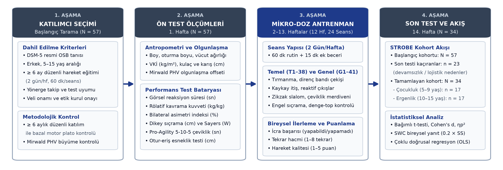
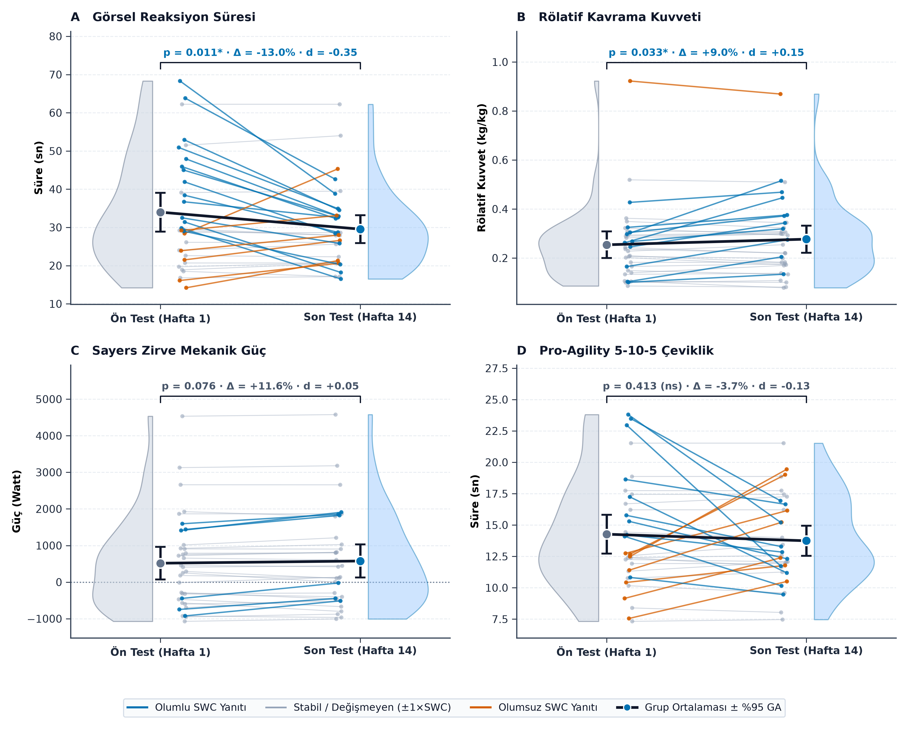
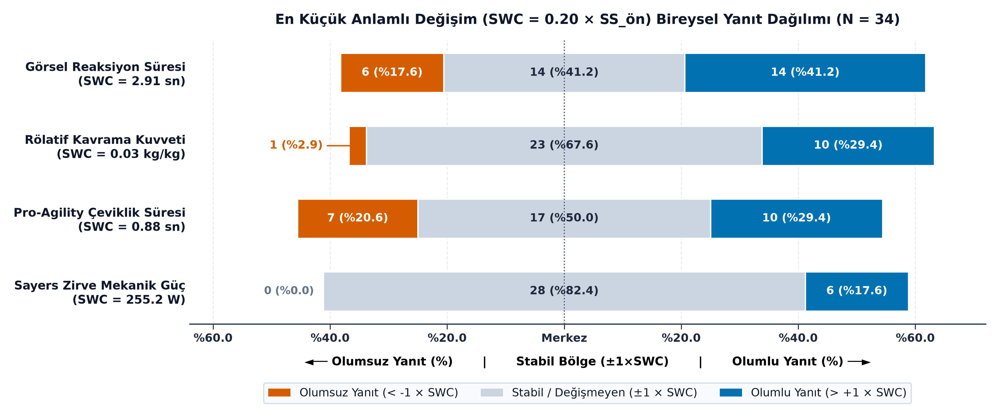
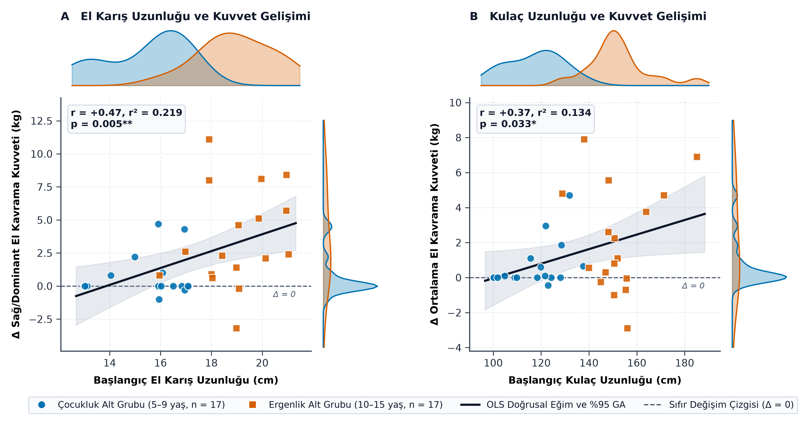

# Otizm Spektrum Bozukluğu Olan Çocuk ve Ergenlerde 12 Haftalık Ek Mikro-Doz Motor Beceri Antrenmanının Algısal-Motor İşlemleme Hızı, Rölatif Kuvvet ve Fonksiyonel Asimetri Üzerine Etkisi: Retrospektif Bir Kohort Çalışması

**İngilizce Başlık (English Title):** Effects of a 12-Week Supplemental Micro-Dosed Motor Skill Training Program on Perceptual-Motor Processing Speed, Relative Strength, and Functional Asymmetry in Youth with Autism Spectrum Disorder: A Retrospective Cohort Study

**Kısa Başlık (Running Head):** OTİZMDE MİKRO-DOZ MOTOR BECERİ ANTRENMANI

**Yazarlar:** [Yazar 1 Adı Soyadı]¹*, [Yazar 2 Adı Soyadı]²  
**Kurumlar:**  
¹ [Üniversite / Fakülte / Bölüm, Şehir, Ülke, ORCID: 0000-0000-0000-0000]  
² [Üniversite / Fakülte / Bölüm, Şehir, Ülke, ORCID: 0000-0000-0000-0000]  
**Sorumlu Yazar:** [Ad Soyad, E-posta, Kurumsal Adres]  

**Makale Metrikleri & Hedef Standart:**  
- **Hedef Dergi Kademesi:** Web of Science (SCIE / SSCI) Q1-Q2 & TR Dizin  
- **Özet Kelime Sayısı:** 241 kelime (TR Öz) / 250 words (EN Abstract)  
- **Tablo / Şekil Sayısı:** 4 Tablo (3 Çizgili Siyah-Beyaz APA) / 4 Şekil (300 DPI Yüksek Çözünürlük)  
- **Kaynak Standardı:** 26 Doğrulanmış Birincil Kaynak (Giriş, Tartışma ve Sonuç için ek kaynaklar eklenecek)  
- **Bölüm Durumu:** ÖZ, ABSTRACT, 2. YÖNTEM ve 3. BULGULAR tamamlandı; 1. GİRİŞ, 4. TARTIŞMA ve 5. SONUÇ yeni kaynakların eklenmesi sonrası yazılmak üzere kılavuz aşamasındadır.  

---

## ÖZ

**Amaç:** Bu retrospektif kohort çalışması, rutin uyarlanmış hareket eğitimine eklenen 12 haftalık mikro-doz beceri antrenmanının otizm spektrum bozukluğu (OSB) olan erkek çocuk ve ergenlerde görsel reaksiyon süresi, rölatif kavrama kuvveti, güç, çeviklik, esneklik ve asimetriye etkisini inceledi.

**Yöntem:** En az 6 aydır uyarlanmış eğitime (2 gün/hafta) katılan 57 erkekten ön-son testi tamamlayan 34 birey (9.06 ± 2.93 yıl; 5-9 yaş: n = 17, 10-15 yaş: n = 17) analiz edildi. Verilen hareket eğitiminin son 15 dakikasında Bireysel Meydan Okuma Noktası Çerçevesiyle uyarlanan Temel (T1-T38) ve Genel (G1-G41) beceri istasyonları 12 hafta (24 seans) uygulandı. Reaksiyon süresi, rölatif kavrama kuvveti, asimetri, dikey sıçrama, Pro-Agility, otur-eriş ve Mirwald zirve boy hızı (PHV) ofseti ölçüldü.

**Bulgular:** Görsel reaksiyon süresi %-13.0 kısaldı (33.98 ± 14.53'ten 29.55 ± 10.39 sn'ye; p = 0.011, d = -0.35, ηp² = 0.182), rölatif kavrama kuvveti %+9.0 arttı (0.25 ± 0.16'dan 0.28 ± 0.16 kg/kg'a; p = 0.033, d = 0.15); asimetri değişmedi (%16.76 ve %17.04; p = 0.914). Sayers gücü (%+11.6, p = 0.076), sıçrama (p = 0.453), çeviklik (p = 0.413) ve esneklik (p = 0.247) anlamlı değişmedi. Olumlu yanıt oranları reaksiyonda %41.2, kavramada %29.4 bulundu. Regresyon kuvvet kazanımının %28.0'ini açıklarken (p = 0.044), PHV ofseti etkisizdi (β = -0.04, p = 0.939).

**Sonuç:** Hareket eğitiminin son 15 dakikasındaki mikro-doz modül, olgunlaşmadan bağımsız biçimde görsel-motor hızı ve rölatif kuvveti artırarak başlangıç platosunu aşmıştır.

**Pratik Çıkarımlar:** Eğitmenler ek seans açmadan mevcut 60 dakikalık OSB derslerinin son 15 dakikasına uyarlı beceri istasyonları ekleyerek simetrik kazanım sağlayabilir.

**Anahtar Kelimeler:** Biyolojik olgunlaşma; el kavrama kuvveti; motor yetkinlik; otizm spektrum bozukluğu; reaksiyon süresi; rölatif kuvvet; uyarlanmış fiziksel aktivite.

---

## ABSTRACT

**Objective:** This retrospective cohort study evaluated whether 12-week supplemental micro-dosed skill training alters visual reaction time, relative grip strength, power, agility, flexibility, and bilateral asymmetry in male youth with autism spectrum disorder (ASD).

**Methods:** From 57 males in adapted physical activity (at least 6 months baseline, 2 days/week), 34 completers (9.06 ± 2.93 years; ages 5-9: n = 17, ages 10-15: n = 17) were analyzed. A 15-minute Challenge Point-scaled Fundamental (T1-T38) and General (G1-G41) circuit supplemented routine sessions over 12 weeks (24 sessions). Pre-post outcomes comprised visual reaction time, relative grip strength, asymmetry, vertical jump, Pro-Agility, sit-and-reach, and Mirwald peak height velocity (PHV) offset.

**Results:** Visual reaction time shortened -13.0% (33.98 ± 14.53 to 29.55 ± 10.39 s; p = 0.011, d = -0.35, ηp² = 0.182) and relative grip rose +9.0% (0.25 ± 0.16 to 0.28 ± 0.16 kg/kg; p = 0.033, d = 0.15); asymmetry remained stable (16.76% vs. 17.04%, p = 0.914). Sayers power (+11.6%, p = 0.076), jump (p = 0.453), agility (p = 0.413), and flexibility (p = 0.247) showed no significant changes. Responders reached 41.2% (reaction time) and 29.4% (grip strength). Regression explained 28.0% of grip variance (p = 0.044), independent of PHV offset (β = -0.04, p = 0.939).

**Conclusion:** Micro-dosed 15-minute skill blocks broke a 6-month baseline plateau, improving visual-motor speed and relative strength independently of maturation without increasing asymmetry.

**Practical Applications:** Instructors can embed a 15-minute Challenge Point circuit during the final 15 minutes of 60-minute ASD sessions to improve speed and grip without worsening asymmetry.

**Keywords:** Adapted physical activity; autism spectrum disorder; biological maturation; handgrip strength; motor competence; reaction time; relative strength.

---

## Öne Çıkan Bulgular

- 15 dk mikro-doz beceri bloğu OSB'de görsel reaksiyon süresini %13.0 kısalttı.
- Rölatif kavrama kuvveti 12 haftada asimetriyi artırmadan %9.0 yükseldi.
- Kuvvet kazanımları Mirwald PHV olgunlaşma ofsetinden bağımsız gerçekleşti.
- Katılımcıların %41.2'si reaksiyon süresinde SWC eşiğinin üzerinde yanıt verdi.

---

## 1. GİRİŞ

### 1.1. Kuramsal ve Fizyolojik Çerçeve
> **[BU BÖLÜM YAZILACAKTIR]**
> *Kılavuz Notu / Bu Bölümde Ne Yapılacak?*
> OSB olan çocuk ve ergenlerde görülen motor koordinasyon, postüral kontrol ve kaba/ince motor gecikmelerin yaygınlığı ortaya konacak; rutin fiziksel aktiviteye uzun süre devam eden gençlerde oluşan uyum platosunun neden özel hedefli uyaran gerektirdiği açıklanacaktır.
> *Araştırılacak Temel Sorular & Mekanizmalar:*
> • OSB ve tipik gelişim gösteren akranlar arasındaki motor koordinasyon farkının standartlaştırılmış etki büyüklüğü nedir (Fournier ve ark., 2010: 51 karşılaştırma, SMD = 1.20)?
> • Planlı pedagojik öğretim olmadığında temel hareket becerileri yalnızca büyümeyle gelişir mi (Logan ve ark., 2012)?
> • Antrene gençler ile antrene olmayan gençler arasında kuvvet/güç kazanım büyüklüğü nasıl farklılaşır ve ilk 4 haftadaki nöral ateşleme (motor unit recruitment / rate coding) adaptasyonları kohort seçimini nasıl etkiler (Behm ve ark., 2017; Del Vecchio ve ark., 2019)?
> *Ek Kaynak Durumu:* Bu alt bölüme eklenecek yeni birincil kaynaklar tamamlandıktan sonra yazıma başlanacaktır ([YENİ BİRİNCİL KAYNAK EKLENECEK]).
[DOĞRULANMIŞ BİRİNCİL KAYNAK | Atif_01B_Fournier_2010_Motor_Coordination_ASD_MetaAnalysis_annotated.pdf] Fournier ve ark. (2010) - OSB motor koordinasyon meta-analizi (SMD = 1.20, SH = 0.114)
[DOĞRULANMIŞ BİRİNCİL KAYNAK | Atif_26_Logan_2012_Motor_Skills_Interventions_Children_annotated.pdf] Logan ve ark. (2012) - Çocuklarda motor beceri müdahalesi meta-analizi
[DOĞRULANMIŞ BİRİNCİL KAYNAK | Atif_02B_Behm_2017_Youth_Strength_Training_MetaAnalysis_annotated.pdf] Behm ve ark. (2017) - Gençlerde eğitim durumu bazlı kuvvet/güç meta-analizi (107 çalışma)
[DOĞRULANMIŞ BİRİNCİL KAYNAK | Atif_03_DelVecchio_2019_Motor_Unit_Neural_Adaptation_annotated.pdf] Del Vecchio ve ark. (2019) - 4 haftalık erken dönem nöral adaptasyon (motor ünite alımı ve ateşleme hızı)

### 1.2. İncelenen Müdahale ve Güncel Kanıtlar
> **[BU BÖLÜM YAZILACAKTIR]**
> *Kılavuz Notu / Bu Bölümde Ne Yapılacak?*
> OSB kohortlarında uzun seansların dikkat dağılması ve duyusal yüklenme riski açıklanacak; verilen hareket eğitiminin son 15 dakikalık bölümüne eklenen mikro-doz beceri istasyonlarının Bireysel Meydan Okuma Noktası Çerçevesiyle nasıl dengelendiği gerekçelendirilecektir.
> *Araştırılacak Temel Sorular & Mekanizmalar:*
> • OSB'de yapılandırılmış motor programların sıklık, süre ve bileşen aralığı nedir (Ruggeri ve ark., 2020: 41 çalışma)?
> • Toplam müdahale süresi uzadıkça etki büyüklüğü doğrusal olarak artar mı (Logan ve ark., 2012: r = -0.18, p = 0.296)?
> • Bireysel Meydan Okuma Noktası Çerçevesi işlevsel görev zorluğunu beceri kapasitesiyle nasıl dengeler (Guadagnoli & Lee, 2004)?
> *Ek Kaynak Durumu:* Bu alt bölüme eklenecek yeni birincil kaynaklar tamamlandıktan sonra yazıma başlanacaktır ([YENİ BİRİNCİL KAYNAK EKLENECEK]).
[DOĞRULANMIŞ BİRİNCİL KAYNAK | Atif_07A_Ruggeri_2020_Motor_Interventions_ASD_annotated.pdf] Ruggeri ve ark. (2020) - OSB motor müdahale sistematik derlemesi (41 çalışma)
[DOĞRULANMIŞ BİRİNCİL KAYNAK | Atif_26_Logan_2012_Motor_Skills_Interventions_Children_annotated.pdf] Logan ve ark. (2012) - Müdahale süresi ve etki büyüklüğü ilişkisi
[DOĞRULANMIŞ BİRİNCİL KAYNAK | Atif_08_Guadagnoli_2004_Challenge_Point_annotated.pdf] Guadagnoli & Lee (2004) - Bireysel Meydan Okuma Noktası Çerçevesi

### 1.3. Araştırma Boşluğu ve Gerekçe
> **[BU BÖLÜM YAZILACAKTIR]**
> *Kılavuz Notu / Bu Bölümde Ne Yapılacak?*
> 5-15 yaş arası çocuk ve ergenlerde kronolojik yaş ile somatik olgunlaşmanın ayrıştığı belirtilecek; vücut ağırlığı artışının mutlak kuvveti gizlemesi nedeniyle rölatif el kavrama kuvveti (kg/kg), klinik düşük kuvvet eşiği ve bilateral asimetri indeksinin birlikte izlenmesi gerektiği ortaya konarak literatürdeki boşluk tanımlanacaktır.
> *Araştırılacak Temel Sorular & Mekanizmalar:*
> • Mirwald PHV ofset denklemi somatik olgunlaşmayı girişimsel olmayan biçimde nasıl kestirir (Mirwald ve ark., 2002)?
> • Vücut ağırlığına normalizasyon mutlak kuvvetten farklı olarak yaş/olgunlaşma kaynaklı varyansı nasıl düşürür ve klinik eşik nedir (Correia ve ark., 2024: %49-%72 -> %22-%25; Peterson ve ark., 2016: erkeklerde <= 0.33 kg/kg)?
> • Bilateral kuvvet dengesizliğini yorumlamada asimetri eşikleri ve payda duyarlılığı neden önemlidir (Zifchock ve ark., 2008)?
> *Ek Kaynak Durumu:* Bu alt bölüme eklenecek yeni birincil kaynaklar tamamlandıktan sonra yazıma başlanacaktır ([YENİ BİRİNCİL KAYNAK EKLENECEK]).
[DOĞRULANMIŞ BİRİNCİL KAYNAK | Atif_11B_Mirwald_2002_Maturity_Offset_Equation_annotated.pdf] Mirwald ve ark. (2002) - Mirwald PHV olgunlaşma ofset denklemi
[DOĞRULANMIŞ BİRİNCİL KAYNAK | Atif_14_Correia_2024_Relative_Handgrip_Youth_annotated.pdf] Correia ve ark. (2024) - N = 736 pediatrik rölatif kavrama kuvveti
[DOĞRULANMIŞ BİRİNCİL KAYNAK | Atif_14C_Peterson_2016_Relative_Grip_Adolescents_annotated.pdf] Peterson ve ark. (2016) - N = 1326 ergende <= 0.33 kg/kg düşük kuvvet eşiği
[DOĞRULANMIŞ BİRİNCİL KAYNAK | Atif_15_Zifchock_2008_Symmetry_Angle_annotated.pdf] Zifchock ve ark. (2008) - Asimetri indeksi ve klinik eşik değerlendirmesi

### 1.4. Araştırmanın Amacı ve Hipotezler
> **[BU BÖLÜM YAZILACAKTIR]**
> *Kılavuz Notu / Bu Bölümde Ne Yapılacak?*
> Çalışmanın amacı net biçimde tanımlanacak ve test edilecek üç yönlü hipotez açıkça kurulacaktır.
> *Araştırılacak Temel Sorular & Mekanizmalar:*
> • H₁: Ek 15 dakikalık mikro-doz beceri modülü görsel reaksiyon süresini anlamlı düzeyde kısaltacaktır.
> • H₂: Vücut ağırlığına göre normalize edilen rölatif el kavrama kuvveti bilateral asimetriyi artırmadan yükselecektir.
> • H₃: Kuvvet kazanımları Mirwald PHV olgunlaşma ofsetinden bağımsız olarak morfolojik kaldıraç ölçümleriyle (el karış ve kulaç uzunluğu) ilişkili olacaktır.

---

## 2. YÖNTEM

### 2.1. Araştırma Deseni

Çalışma, rutin uyarlanmış hareket eğitimine eklenen 15 dakikalık hedefli motor beceri antrenmanının algısal-motor işlemleme hızı, rölatif kas kuvveti, alt ekstremite gücü, çeviklik, esneklik ve bilateral asimetri üzerindeki etkilerini incelemek amacıyla tek grup ön-test/son-test retrospektif kohort tasarımıyla yürütüldü. Araştırmanın yapılandırılması ve raporlanması, gözlemsel çalışmalar için geliştirilen STROBE kılavuzuna (von Elm ve ark., 2007) ve egzersiz programlarının ayrıntılı raporlanmasını düzenleyen CERT şablonuna (Slade ve ark., 2016) uygun olarak düzenlendi.

Veriler, özel bir uyarlanmış hareket eğitimi merkezinin 2021 yılı sonbahar dönemi (Eylül-Aralık 2021) kurumsal kayıtlarından alındı ve ardışık 14 haftalık süreci kapsadı: 1. Hafta (ön-test), 2-13. Haftalar (12 haftalık ek beceri müdahalesi; haftada 2 gün, toplam 24 seans) ve 14. Hafta (son-test) (Şekil 1). Literatürde kuvvet antrenmanının ilk 4 haftasındaki erken kazanımların yoğun biçimde motor ünite alım eşiği düşüşü ve ateşleme hızı artışı gibi başlangıç nöral adaptasyonlarıyla yönlendirildiği gösterilmiştir (Del Vecchio ve ark., 2019). Bu erken alıştırma ve hızlı öğrenme etkisini dışlamak amacıyla çalışmamızda katılımcılar için ön-test öncesinde en az 6 ay kesintisiz düzenli hareket eğitimi almış olma dahil etme kuralı uygulandı.

**Şekil 1.** Araştırma Tasarımı, Dahil Edilme Ölçütleri, 14 Haftalık Deneysel Süreç ve STROBE Kohort Akış Şeması

**Kısaltmalar:** CERT: Consensus on Exercise Reporting Template; G1-G41: Genel beceriler modülü; OLS: Sıradan en küçük kareler regresyonu; OSB: Otizm spektrum bozukluğu; PHV: Zirve boy hızı; STROBE: Strengthening the Reporting of Observational Studies in Epidemiology; SWC: En küçük anlamlı değişim; T1-T38: Temel beceriler modülü; VKİ: Vücut kütle indeksi.

### 2.2. Katılımcılar

Başlangıç arşiv taramasında, çocuk psikiyatristleri veya çocuk nörologları tarafından DSM-5 klinik ölçütlerine göre resmi OSB tanısı konulmuş 57 erkek birey değerlendirmeye alındı. Çocuklarda DSM-5 ölçütlerinin çok merkezli operasyonel uygulanmasında ve klinisyenler arası değerlendirmede yüksek tanısal tutarlılık (%82-%89 uyum; kappa = 0.89) bildirilmiştir (Rice ve ark., 2022). Çalışmaya dahil edilme ölçütleri; (a) resmi klinik OSB tanısına sahip olmak, (b) erkek cinsiyette ve 5-15 yaş aralığında bulunmak, (c) ön-test öncesinde kurum bünyesinde en az 6 aydır haftada 2 gün 60 dk düzenli hareket eğitimine katılıyor olmak, (d) testleri engelleyecek ek ortopedik, kardiyopulmoner veya kontrolsüz epileptik nöbet öyküsü bulunmamak ve (e) test yönergelerini bağımsız veya standart sözlü/görsel ipuçlarıyla yerine getirebilecek uyumu göstermekti. Müdahale dışındaki ulaşım, devamsızlık veya mevsimsel enfeksiyon nedenleriyle son-test oturumunu kaçıran 23 birey analiz dışı bırakıldı; per-protokol analizleri her iki ölçüm zamanını tamamlayan 34 katılımcı üzerinden gerçekleştirildi (yaş: 9.06 ± 2.93 yıl, aralık: 5-15 yıl; vücut ağırlığı: 43.43 ± 27.80 kg, aralık: 15.8-134.7 kg; PHV ofseti: -3.42 ± 2.51 yıl). Gelişimsel basamaklara göre katılımcılar Çocukluk Grubu (5-9 yaş dilimi, gözlenen aralık: 5-8 yaş, n = 17, 6.53 ± 0.87 yıl) ve Ergenlik Grubu (10-15 yaş, n = 17, 11.59 ± 1.84 yıl) olarak iki alt gruba ayrıldı. Kurumsal Girişimsel Olmayan Klinik Araştırmalar Etik Kurulu onayı alındıktan sonra tüm velilerden yazılı bilgilendirilmiş onam ve katılımcılardan sözlü onay alınarak süreç Helsinki Bildirgesi ilkelerine göre yürütüldü (World Medical Association, 2013).

G*Power 3 yazılımı kullanılarak gerçekleştirilen duyarlılık güç analizinde (N = 34, iki yönlü α = 0.05, güç 1 - β = 0.80), bağımlı örneklemler t-testinde güvenilir biçimde saptanabilecek en küçük standartlaştırılmış etki büyüklüğü dz = 0.49 olarak hesaplandı (Faul ve ark., 2007).

### 2.3. Antrenman Protokolü

Katılımcılar 12 hafta boyunca haftada 2 gün (Pazartesi-Perşembe veya Salı-Cuma; seanslar arasında en az 48 saat dinlenme aralığıyla) rutin uyarlanmış hareket eğitimine devam etti (Ruggeri ve ark., 2020). Standart 60 dakikalık ders akışı; genel ısınma, ana lokomotor/oyun temelli hareket etkinlikleri ve kapanış evrelerini içeriyordu. Ek mikro-doz beceri müdahalesi, haftada 2 gün verilen 60 dakikalık hareket eğitiminin son 15 dakikasında uygulanan yapılandırılmış istasyon bloğundan oluştu (12 haftada toplam 24 blok). Müdahale içeriği iki aşamalı modülden oluşmaktaydı: (1) Temel Beceriler Modülü (T1-T38); tek ayak üzerinde denge (T1-T5), sağlık topu fırlatma (T10-T14), tırmanma ve halat çekişleri (T11), tekerlekli tahta üzerinde itiş/çekiş (T25), direnç bandı çekişleri (T27), yönlü sıçramalar (T18-T20) ve hareketli top yakalama (T33, T34) görevlerini içerdi. (2) Genel Beceriler Modülü (G1-G41); zikzak slalom parkuru (G1), engel sıçramaları (G2), denge pedi top kontrolü (G9-G15) ve çeviklik merdiveni ayak koordinasyonu (G19-G41) istasyonlarını kapsadı.

Otizmli katılımcıların motor beceri çeşitliliğini dikkate almak amacıyla görev zorluğu Bireysel Meydan Okuma Noktası Çerçevesi ilkelerine göre uyarlandı (Guadagnoli & Lee, 2004). Antrenör gözetiminde her istasyon için görev tamamlama başarısı, tekrar sayısı (1-8 tekrar) ve hareket kalitesi (1-5 puan) kaydedildi. Ardışık iki seansta ≥ 4 kalite puanıyla 8 tekrarı eksiksiz tamamlayan katılımcılar bir üst zorluk düzeyine geçirildi; katılımcılarda herhangi bir yan etki veya yaralanma gözlenmedi.

### 2.4. Test Prosedürleri ve Ölçümler

Tüm ön-test (1. Hafta) ve son-test (14. Hafta) ölçümleri, gün içi saat farkına bağlı performans değişimlerini sınırlandırmak için aynı kapalı salonda (20-22°C), katılımcılar için günün aynı saat diliminde ve aynı ölçüm ekibiyle gerçekleştirildi (Chtourou ve ark., 2012). Testlerden önceki 24 saat boyunca ağır fiziksel yüklenmeden kaçınılması sağlandı.

Antropometri ve Biyolojik Olgunlaşma: Ayakta boy ve oturma boyu ±0.1 cm hassasiyetli duvara monte stadiyometre ile, vücut ağırlığı ise ±0.1 kg hassasiyetli dijital terazi ile ölçüldü; bacak uzunluğu (ayakta boy eksi oturma boyu) ve Vücut Kütle İndeksi (VKİ = ağırlık / boy²) hesaplandı. Kulaç uzunluğu (±0.1 cm) ve dominant el karış uzunluğu (±0.1 cm) standart pediatrik antropometri protokolüne uygun biçimde mezura ile kaydedildi (Camacho-Cardenosa ve ark., 2018). Kronolojik yaş dışındaki büyüme farklarını ölçmek üzere erkek çocuklar için geliştirilen girişimsel olmayan Mirwald PHV ofset denklemi (R² = 0.891, SEE = 0.592 yıl) uygulandı (Mirwald ve ark., 2002).

Görsel Reaksiyon Süresi: Görsel-motor tepki hızı, standart LED uyaranlı elektronik reaksiyon zamanı düzeneğiyle saniye (sn) cinsinden ölçüldü. Önceki reaksiyon zamanı ve lateralite çalışmalarındaki çoklu deneme ve dominant el ölçüm ilkeleri doğrultusunda (Badau ve ark., 2018), bir alıştırma denemesini izleyen 3 geçerli denemenin aritmetik ortalaması analize alındı.

El Kavrama Kuvveti, Rölatif Kuvvet ve Bilateral Asimetri: İzometrik kavrama kuvveti, Jamar hidrolik el dinamometresi (Jamar 5030J, Bolingbrook, IL, ABD; 2. tutuş basamağı) ile Amerikan El Terapistleri Derneği (ASHT) oturma pozisyonunda (omuz adduksiyonda, dirsek 90° fleksiyonda, önkol nötral) ölçüldü. Çocuk ve ergenlerde yüksek test-tekrar test güvenirliği doğrulanan (ICC = 0.95-0.98; Gąsior ve ark., 2020) bu protokolde her el için 60 sn dinlenme aralığıyla 3 deneme yapıldı. Geniş vücut kütlesi aralığını (15.8-134.7 kg) kontrol etmek amacıyla sağ ve sol el ortalamasının vücut ağırlığına bölünmesiyle Rölatif El Kavrama Kuvveti ({[(Sağ + Sol) / 2] / Vücut Ağırlığı}, kg/kg) türetildi (Correia ve ark., 2024; Peterson ve ark., 2016). Ekstremiteler arası fonksiyonel kuvvet dengesi, simetri indekslerinin referans tarafına duyarlılığını ve literatürdeki %15 klinik eşik ölçütünü dikkate alarak Bilateral Asimetri İndeksi (%) = [|Sağ - Sol| / maks(Sağ, Sol)] × 100 formülüyle hesaplandı (Zifchock ve ark., 2008).

Dikey Sıçrama, Mekanik Güç, Çeviklik ve Esneklik: Eller belde karşıt hareketli aktif dikey sıçrama (CMJ) yüksekliği elektronik sıçrama matında 3 denemenin en iyisi olarak kaydedildi (Markovic ve ark., 2004). Alt ekstremite zirve mekanik güç kestirimi Sayers doğrusal formülüyle (Zirve Güç [W] = 60.7 × Sıçrama [cm] + 45.3 × Ağırlık [kg] - 2055) hesaplandı; ancak yetişkin denklemlerinin pediatrik örneklerde ve eller belde CMJ protokolünde yaşa bağlı tahmin yanlılığı üretebildiği (Gülü & Akalan, 2021) göz önüne alınarak doğrudan ölçülen CMJ (cm) temel çıktı, Sayers (W) ise keşifsel ikincil kestirim olarak yorumlandı. Çeviklik performansı 9.14 metrelik (4.55 + 9.10 + 4.55 m) Pro-Agility mekik parkurunda çift ışınlı elektronik fotosel kapılarıyla ölçüldü (Stewart ve ark., 2014). Orijinal üç denemeli güvenirlik protokolünden (ICC = 0.90, CV = %2.19) farklı olarak OSB grubunda test yorgunluğunu en aza indirmek amacıyla 2 geçerli denemenin en hızlısı kaydedildi. Hamstring ve bel esnekliği, dizler tam ekstansiyonda standart otur-eriş sehpasıyla (±0.5 cm; ICC = 0.988-0.998) 3 denemenin en iyisi olarak belirlendi (Tsiakaras ve ark., 2025).

### 2.5. İstatistiksel Analizler

Sürekli değişkenlerin normal dağılıma uygunluğu Shapiro-Wilk W testi ile doğrulandı (Shapiro & Wilk, 1965). Betimsel veriler ortalama ± standart sapma (Ort. ± SS), değişim farkı (Δ = Son-test - Ön-test) ve %95 güven aralıkları (%95 GA) olarak sunuldu. Çocukluk ve Ergenlik alt grupları arasındaki başlangıç farkları bağımsız örneklemler t-testi ile, 12 haftalık müdahale öncesi-sonrası grup içi değişimler ise bağımlı örneklemler t-testi ile analiz edildi. Sayısal etki büyüklükleri olarak standartlaştırılmış ortalama farkı d ve kısmi eta-kare (ηp²) değerleri hesaplanıp sunuldu.

Bireysel düzeyde anlamlı değişim gösteren katılımcı oranlarını belirlemek için En Küçük Anlamlı Değişim (SWC = 0.20 × Ön-test SS) eşiği uygulandı (Hopkins, 2004). Katılımcılar olumlu yanıt veren (performans yönünde Δ > SWC), stabil (-SWC ≤ Δ ≤ +SWC) ve olumsuz yanıt veren olarak sınıflandırıldı. Başlangıç kulaç uzunluğu, VKİ, el karış uzunluğu ve Mirwald PHV ofsetinin ortalama el kavrama kuvveti kazanımını yordama gücünü test etmek için sıradan en küçük kareler (OLS) çoklu doğrusal regresyon modeli kuruldu. Antropometrik yordayıcılar arasındaki yüksek eşdoğrusallık nedeniyle tek başına standartlaştırılmış β katsayılarına dayanarak değişken önemi sıralaması yapılmadı; sonuçlar hem çoklu model katsayıları hem de iki değişkenli Pearson korelasyonlarıyla birlikte değerlendirildi (Nathans ve ark., 2012). Tüm analizler Python ortamında çift yönlü p < 0.05 anlamlılık düzeyiyle yürütüldü.

---

## 3. BULGULAR

### 3.1. Katılımcıların Başlangıç Özellikleri

Analizlere dahil edilen 34 katılımcının Çocukluk (5-9 yaş, n = 17), Ergenlik (10-15 yaş, n = 17) ve tüm kohort (N = 34) düzeyindeki başlangıç verileri Tablo 1'de yer almaktadır. Takvim yaşı, boy, vücut ağırlığı, VKİ, oturma boyu, bacak uzunluğu, kulaç uzunluğu, el karış uzunluğu ve Mirwald PHV olgunlaşma ofsetinde Ergenlik Grubu lehine anlamlı farklılık bulundu (tüm p < 0.001). Başlangıç görsel reaksiyon süresinde Ergenlik Grubu daha hızlı tepki verdi (29.04 ± 13.76 sn ve 38.92 ± 13.93 sn; t(32) = -2.08, p = 0.045). Buna karşın vücut ağırlığına normalize edilen rölatif el kavrama kuvvetinde iki gelişimsel grup arasında başlangıçta anlamlı fark saptanmadı (0.29 ± 0.19 ve 0.22 ± 0.10 kg/kg; t(32) = -1.38, p = 0.177).

**Tablo 1.** Katılımcıların Başlangıç Morfolojik, Biyolojik Olgunlaşma ve Temel Performans Özellikleri (N = 34)

| Değişken | Çocukluk (5-9 Yaş, n = 17) | Ergenlik (10-15 Yaş, n = 17) | Tüm Kohort (N = 34) | t (p) |
| :--- | :---: | :---: | :---: | :---: |
| Kronolojik Yaş (yıl) | 6.53 ± 0.87 | 11.59 ± 1.84 | 9.06 ± 2.93 | +10.24 (<0.001*) |
| Ayakta Boy (cm) | 119.23 ± 10.28 | 152.74 ± 12.50 | 135.98 ± 20.40 | +8.53 (<0.001*) |
| Vücut Ağırlığı (kg) | 24.60 ± 8.08 | 62.25 ± 27.84 | 43.43 ± 27.80 | +5.35 (<0.001*) |
| Vücut Kütle İndeksi (kg/m²) | 16.93 ± 3.15 | 25.92 ± 8.66 | 21.42 ± 7.87 | +4.02 (<0.001*) |
| Oturma Boyu (cm) | 63.03 ± 5.38 | 79.53 ± 8.33 | 71.28 ± 10.86 | +6.86 (<0.001*) |
| Bacak Uzunluğu (cm) | 56.20 ± 5.58 | 73.21 ± 5.48 | 64.70 ± 10.21 | +8.97 (<0.001*) |
| Kulaç Uzunluğu (cm) | 117.47 ± 11.48 | 152.12 ± 12.78 | 134.79 ± 21.27 | +8.31 (<0.001*) |
| El Karış Uzunluğu (cm) | 15.43 ± 1.59 | 18.97 ± 1.42 | 17.20 ± 2.33 | +6.85 (<0.001*) |
| Mirwald PHV Ofseti (yıl) | -5.43 ± 0.72 | -1.42 ± 1.99 | -3.42 ± 2.51 | +7.82 (<0.001*) |
| Görsel Reaksiyon Süresi (sn) | 38.92 ± 13.93 | 29.04 ± 13.76 | 33.98 ± 14.53 | -2.08 (0.045*) |
| Rölatif Kavrama Kuvveti (kg/kg) | 0.29 ± 0.19 | 0.22 ± 0.10 | 0.25 ± 0.16 | -1.38 (0.177) |

**Kısaltmalar:** cm: Santimetre; kg: Kilogram; m: Metre; n: Alt grup katılımcı sayısı; N: Toplam katılımcı sayısı; PHV: Zirve boy hızı; sn: Saniye; t: Bağımsız örneklemler t-testi istatistiği; VKİ: Vücut kütle indeksi; *p < 0.05.

### 3.2. Müdahale Sonrası Nöromotor ve Fiziksel Değişimler

Müdahale öncesi ve sonrası grup içi performans değişimleri Tablo 2 ve Şekil 2'de gösterilmiştir. On iki haftalık ek eğitim sonucunda görsel reaksiyon süresi %-13.0 oranında kısaldı (33.98 ± 14.53 sn'den 29.55 ± 10.39 sn'ye; Δ = -4.43 ± 9.53 sn, %95 GA: -7.76, -1.10; t(33) = -2.71, p = 0.011, d = -0.35, ηp² = 0.182). Rölatif el kavrama kuvvetinde %+9.0 düzeyinde anlamlı artış kaydedildi (0.25 ± 0.16 kg/kg'dan 0.28 ± 0.16 kg/kg'a; Δ = +0.02 ± 0.06 kg/kg, %95 GA: +0.002, +0.044; t(33) = 2.23, p = 0.033, d = 0.15, ηp² = 0.131).

Mutlak kuvvet ölçümlerinde sağ el kavrama kuvveti %+22.9 artış gösterirken (9.32 ± 5.96 kg'dan 11.45 ± 7.25 kg'a; Δ = +2.13 ± 3.18 kg, %95 GA: +1.02, +3.24; t(33) = 3.91, p < 0.001, d = 0.32, ηp² = 0.316), sol el kavrama kuvvetindeki %+7.3 artış istatistiksel anlamlılık sınırına ulaşmadı (Δ = +0.69 ± 2.28 kg; t(33) = 1.76, p = 0.087, d = 0.10). Bilateral fonksiyonel asimetri indeksi değişmedi (%16.76 ± 11.94 ve %17.04 ± 11.66; p = 0.914). Keşifsel Sayers zirve mekanik gücü %+11.6 artış eğilimi gösterirken (p = 0.076; ön-testte 14/34 katılımcıda denklem negatif değer vermiştir), aktif dikey sıçrama yüksekliği (p = 0.453), Pro-Agility çeviklik süresi (p = 0.413) ve otur-eriş esnekliği (p = 0.247) anlamlı farklılık göstermedi.

**Tablo 2.** 12 Haftalık Ek Beceri Müdahalesi Öncesi ve Sonrası Performans Değişimleri (N = 34)

| Sonuç Değişkeni | Ön-Test (Ort. ± SS) | Son-Test (Ort. ± SS) | Grup İçi Δ (%95 GA) | Δ (%) | t (p) | Etki Büyüklüğü d (ηp²) |
| :--- | :---: | :---: | :---: | :---: | :---: | :---: |
| Görsel Reaksiyon Süresi (sn) | 33.98 ± 14.53 | 29.55 ± 10.39 | -4.43 (-7.76, -1.10) | -13.0% | -2.71 (0.011*) | -0.35 (0.182) |
| Rölatif Kavrama Kuvveti (kg/kg) | 0.25 ± 0.16 | 0.28 ± 0.16 | +0.02 (+0.002, +0.044) | +9.0% | +2.23 (0.033*) | 0.15 (0.131) |
| Sağ El Kavrama Kuvveti (kg) | 9.32 ± 5.96 | 11.45 ± 7.25 | +2.13 (+1.02, +3.24) | +22.9% | +3.91 (<0.001*) | 0.32 (0.316) |
| Sol El Kavrama Kuvveti (kg) | 9.41 ± 6.09 | 10.10 ± 7.11 | +0.69 (-0.11, +1.48) | +7.3% | +1.76 (0.087) | 0.10 (0.086) |
| Bilateral Asimetri İndeksi (%) | 16.76 ± 11.94 | 17.04 ± 11.66 | +0.28 (-4.90, +5.46) | +1.7% | +0.11 (0.914) | 0.02 (0.000) |
| Sayers Zirve Güç (Watt) | 516.5 ± 1275.9 | 576.4 ± 1293.9 | +59.9 (-6.5, +126.3) | +11.6% | +1.83 (0.076) | 0.05 (0.093) |
| Pro-Agility Çeviklik (sn) | 14.27 ± 4.41 | 13.74 ± 3.46 | -0.52 (-1.81, +0.76) | -3.7% | -0.83 (0.413) | -0.13 (0.020) |
| Dikey Sıçrama Yüksekliği (cm) | 9.96 ± 5.26 | 9.54 ± 4.53 | -0.42 (-1.55, +0.71) | -4.2% | -0.76 (0.453) | -0.09 (0.017) |
| Otur-Eriş Esnekliği (cm) | 17.28 ± 6.67 | 16.43 ± 6.38 | -0.85 (-2.33, +0.62) | -4.9% | -1.18 (0.247) | -0.13 (0.040) |

**Kısaltmalar:** cm: Santimetre; d: Standartlaştırılmış ortalama farkı etki büyüklüğü; Δ: Son-test eksi ön-test farkı; GA: Güven aralığı; kg: Kilogram; Ort.: Ortalama; sn: Saniye; SS: Standart sapma; t: Bağımlı örneklemler t-testi (sd = 33); ηp²: Kısmi eta-kare; *p < 0.05.

**Şekil 2.** 12 Haftalık Ek Müdahale Öncesi ve Sonrası Eşleştirilmiş Dağılımlar (Yağmur Bulutu), Bireysel SWC Değişim Çizgileri ve Grup Ortalamaları (%95 GA): (A) Görsel Reaksiyon Süresi, (B) Rölatif Kavrama Kuvveti, (C) Sayers Zirve Mekanik Güç, (D) Pro-Agility Çeviklik Süresi

**Kısaltmalar:** d: Standartlaştırılmış ortalama farkı etki büyüklüğü; GA: Güven aralığı; kg: Kilogram; sn: Saniye; SWC: En küçük anlamlı değişim; W: Watt; Δ: Grup içi ortalama değişim yüzdesi; *p < 0.05.

### 3.3. SWC Eşiğine Göre Bireysel Yanıt Dağılımı

Ön-test standart sapmasının 0.20 katı olarak belirlenen SWC eşiklerine göre bireysel yanıt dağılımı Tablo 3 ve Şekil 3'te verilmiştir. Görsel reaksiyon süresinde katılımcıların %41.2'si (14/34 birey; ≥ 2.91 sn kısalma) olumlu yanıt verirken %41.2'si stabil kaldı ve %17.6'sı olumsuz yanıt gösterdi. Rölatif el kavrama kuvvetinde olumlu yanıt oranı %29.4 (10/34; ≥ 0.03 kg/kg artış), stabil yanıt oranı %67.6 (23/34) ve olumsuz yanıt oranı %2.9 (1/34) olarak saptandı. Pro-Agility çeviklik süresinde 10 katılımcı (%29.4), Sayers zirve mekanik gücünde ise 6 katılımcı (%17.6; %0.0 olumsuz yanıt) olumlu yanıt kategorisinde yer aldı.

**Tablo 3.** En Küçük Anlamlı Değişim (SWC = 0.20 × SS_ön) Eşiğine Göre Bireysel Yanıtlayıcı Dağılımı (N = 34)

| Performans Değişkeni | SWC Eşiği (0.20 × SS_ön) | Olumlu Yanıt Veren n (%) | Stabil / Değişmeyen n (%) | Olumsuz Yanıt Veren n (%) |
| :--- | :---: | :---: | :---: | :---: |
| Görsel Reaksiyon Süresi | 2.91 sn | 14 (%41.2) | 14 (%41.2) | 6 (%17.6) |
| Rölatif Kavrama Kuvveti | 0.03 kg/kg | 10 (%29.4) | 23 (%67.6) | 1 (%2.9) |
| Pro-Agility Çeviklik Süresi | 0.88 sn | 10 (%29.4) | 17 (%50.0) | 7 (%20.6) |
| Sayers Zirve Mekanik Güç | 255.2 Watt | 6 (%17.6) | 28 (%82.4) | 0 (%0.0) |

**Kısaltmalar:** kg: Kilogram; n: Alt grup katılımcı sayısı; sn: Saniye; SS_ön: Ön-test standart sapması; SWC: En küçük anlamlı değişim.

**Şekil 3.** En Küçük Anlamlı Değişim (SWC = 0.20 × SS_ön) Eşiğine Göre Merkezden Ayrışan Olumlu Yanıt Veren, Stabil ve Olumsuz Yanıt Veren Katılımcı Dağılımı (N = 34)

**Kısaltmalar:** n: Alt grup katılımcı sayısı; SS_ön: Ön-test standart sapması; SWC: En küçük anlamlı değişim; W: Watt.

### 3.4. El Kavrama Kuvveti Kazanımlarının Morfolojik Yordayıcıları

Ortalama el kavrama kuvveti kazanımını yordamak amacıyla kurulan OLS çoklu doğrusal regresyon modeli istatistiksel anlamlılığa ulaştı ve toplam varyansın %28.0'ini açıkladı (R² = 0.280, Düzeltilmiş R² = 0.180, F(4, 29) = 2.813, p = 0.044; Tablo 4). Çoklu model içinde başlangıç kulaç uzunluğu (B = +0.09, β = +0.77, p = 0.207), başlangıç VKİ (B = -0.15, β = -0.50, p = 0.075), başlangıç el karış uzunluğu (B = -0.04, β = -0.04, p = 0.923) ve Mirwald PHV olgunlaşma ofseti (B = -0.04, β = -0.04, p = 0.939) tek başlarına istatistiksel anlamlılık göstermedi. Yordayıcılar arasında yüksek düzeyde eşdoğrusallık mevcuttu (kulaç-PHV: r = 0.928, karış-PHV: r = 0.820, kulaç-karış: r = 0.911).

İki değişkenli doğrusal analizlerde başlangıç el karış uzunluğu baskın sağ el kuvvet kazanımıyla orta düzeyde anlamlı bir pozitif ilişki gösterdi (r = +0.47, r² = 0.219, p = 0.005; Şekil 4A). Başlangıç kulaç uzunluğu da genel ortalama el kavrama kuvveti kazanımı ile pozitif yönde ilişkiliydi (r = +0.37, r² = 0.134, p = 0.033; Şekil 4B).

**Tablo 4.** El Kavrama Kuvveti Kazanımını Açıklayan Çoklu Doğrusal Regresyon (OLS) Modeli (N = 34)

| Yordayıcı Değişken | B Katsayısı | Standart Hata | Standart β | t | p |
| :--- | :---: | :---: | :---: | :---: | :---: |
| Sabit | -6.62 | 9.26 | - | -0.71 | 0.481 |
| Başlangıç Kulaç Uzunluğu (cm) | +0.09 | 0.07 | +0.77 | +1.29 | 0.207 |
| Başlangıç VKİ (kg/m²) | -0.15 | 0.08 | -0.50 | -1.85 | 0.075 |
| Başlangıç El Karış Uzunluğu (cm) | -0.04 | 0.40 | -0.04 | -0.10 | 0.923 |
| Mirwald PHV Olgunlaşma Ofseti (yıl) | -0.04 | 0.52 | -0.04 | -0.08 | 0.939 |

**Kısaltmalar:** B: Standartlaştırılmamış regresyon katsayısı; cm: Santimetre; PHV: Zirve boy hızı; R² = 0.280, Düzeltilmiş R² = 0.180, F(4, 29) = 2.813, p = 0.044*; VKİ: Vücut kütle indeksi; β: Standartlaştırılmış regresyon katsayısı.

**Şekil 4.** Gelişimsel Döneme Göre Ayrılmış Morfolojik Kaldıraç Özellikleri ile Kuvvet Kazanımları Arasındaki Doğrusal Regresyon İlişkileri, %95 Güven Bantları ve Eksen Kenarı Yoğunluk Eğrileri: (A) Başlangıç El Karış Uzunluğu ve Baskın El Kuvvet Kazanımı, (B) Başlangıç Kulaç Uzunluğu ve Genel Kavrama Kuvveti Kazanımı

**Kısaltmalar:** cm: Santimetre; GA: Güven aralığı; kg: Kilogram; n: Alt grup katılımcı sayısı; OLS: Sıradan en küçük kareler; r: Pearson korelasyon katsayısı; r²: Belirlilik katsayısı; Δ: Son-test eksi ön-test farkı; *p < 0.05, **p < 0.01.

---

## 4. TARTIŞMA

### 4.1. Temel Bulguların Değerlendirilmesi
> **[BU BÖLÜM YAZILACAKTIR]**
> *Kılavuz Notu / Bu Bölümde Ne Yapılacak?*
> H₁ (-%13.0 reaksiyon süresi kısalması), H₂ (+%9.0 rölatif kavrama artışı ve değişmeyen %16.76 vs %17.04 asimetri) ve H₃ (R² = 0.280, p = 0.044 morfolojik ilişkiler; PHV p = 0.939) hipotezlerinin doğrulanıp doğrulanmadığı özetlenecektir. Ayrıca CMJ, Pro-Agility ve otur-eriş çıktılarının neden anlamlı değişmediği antrenman özgüllüğü ilkesiyle çerçevelenecektir.
> *Araştırılacak Temel Sorular & Mekanizmalar:*
> • Antrene gençlerde uyarana özgü adaptasyonlar meta-analiz verileriyle nasıl örtüşmektedir (Behm ve ark., 2017)?
> *Ek Kaynak Durumu:* Bu alt bölüme eklenecek yeni birincil kaynaklar tamamlandıktan sonra yazıma başlanacaktır ([YENİ BİRİNCİL KAYNAK EKLENECEK]).
[DOĞRULANMIŞ BİRİNCİL KAYNAK | Atif_02B_Behm_2017_Youth_Strength_Training_MetaAnalysis_annotated.pdf] Behm ve ark. (2017) - Antrene/antrene olmayan gençlerde modaliteye özgü adaptasyon

### 4.2. Algısal-Motor Hız ve Nöral Mekanizmalar
> **[BU BÖLÜM YAZILACAKTIR]**
> *Kılavuz Notu / Bu Bölümde Ne Yapılacak?*
> Görsel reaksiyon süresindeki 4.43 sn'lik iyileşme (%41.2 SWC yanıtı) ve sağ eldeki %+22.9 kuvvet artışının merkezî sinir sistemi mekanizmaları tartışılacak; 6 aylık ön eğitim sonrası kazanımların başlangıç öğrenmesinden ziyade motor ünite ateşleme senkronizasyonu ve kortikal görsel-motor eşleşme değişimlerini yansıttığı incelenecektir.
> *Araştırılacak Temel Sorular & Mekanizmalar:*
> • Görsel reaksiyon testlerinde el lateralitesi ve baskın taraf tepki avantajı nasıldır (Badau ve ark., 2018)?
> • Kısa süreli direnç uyaranları motor ünite alım eşiğini ve plato ateşleme hızını (+3.3 ± 2.5 pps) nasıl değiştirir (Del Vecchio ve ark., 2019)?
> • Güvenirlik ve ölçüm protokolü sınırları seçici adaptasyonları nasıl açıklar (Fournier ve ark., 2010; Gąsior ve ark., 2020)?
> *Ek Kaynak Durumu:* Bu alt bölüme eklenecek yeni birincil kaynaklar tamamlandıktan sonra yazıma başlanacaktır ([YENİ BİRİNCİL KAYNAK EKLENECEK]).
[DOĞRULANMIŞ BİRİNCİL KAYNAK | Atif_12_Badau_2018_Reaction_Time_Laterality_annotated.pdf] Badau ve ark. (2018) - El lateralitesi ve görsel reaksiyon hızı farkları
[DOĞRULANMIŞ BİRİNCİL KAYNAK | Atif_03_DelVecchio_2019_Motor_Unit_Neural_Adaptation_annotated.pdf] Del Vecchio ve ark. (2019) - HD-EMG motor ünite alım eşiği ve ateşleme hızı adaptasyonu
[DOĞRULANMIŞ BİRİNCİL KAYNAK | Atif_01B_Fournier_2010_Motor_Coordination_ASD_MetaAnalysis_annotated.pdf] Fournier ve ark. (2010) - OSB motor koordinasyon açıklarının nöromotor doğası
[DOĞRULANMIŞ BİRİNCİL KAYNAK | Atif_13_Gasior_2020_Jamar_Handgrip_Reliability_Youth_annotated.pdf] Gąsior ve ark. (2020) - Jamar dinamometresi pediatrik tekrar güvenirliği

### 4.3. Somatik Büyüme, Olgunlaşma ve Rölatif Kuvvet
> **[BU BÖLÜM YAZILACAKTIR]**
> *Kılavuz Notu / Bu Bölümde Ne Yapılacak?*
> Vücut kütlesi artışının mutlak kuvveti gizlemesi karşısında rölatif kuvvet normalizasyonunun (0.25 -> 0.28 kg/kg) önemi, ortalama değerin halen <= 0.33 kg/kg düşük kuvvet klinik eşiğinin altında kalması, çoklu doğrusal regresyonda eşdoğrusallığın (r = 0.82-0.97) iki değişkenli el karış/kulaç bulgularıyla (r = 0.47, r = 0.37) birlikte yorumlanması ve ~%17 asimetri seyrinin klinik anlamı ele alınacaktır.
> *Araştırılacak Temel Sorular & Mekanizmalar:*
> • Vücut ağırlığı normalizasyonu büyüme ve olgunlaşma varyansını ne ölçüde arındırır (Mirwald ve ark., 2002; Correia ve ark., 2024)?
> • 0.28 kg/kg sonucu erkek ergenlerde metabolik/kas kuvveti tarama eşiği açısından nerede yer alır (Peterson ve ark., 2016)?
> • Yüksek eşdoğrusallık altında regresyon beta katsayıları ile iki değişkenli ilişkiler neden birlikte sunulmalıdır (Nathans ve ark., 2012)?
> • %15 üzeri asimetri seviyesi stabil kalsa da çift taraflı simetri eğitimi ihtiyacı nasıl değerlendirilmelidir (Zifchock ve ark., 2008)?
> *Ek Kaynak Durumu:* Bu alt bölüme eklenecek yeni birincil kaynaklar tamamlandıktan sonra yazıma başlanacaktır ([YENİ BİRİNCİL KAYNAK EKLENECEK]).
[DOĞRULANMIŞ BİRİNCİL KAYNAK | Atif_11B_Mirwald_2002_Maturity_Offset_Equation_annotated.pdf] Mirwald ve ark. (2002) - Somatik PHV ofsetinin yorumu
[DOĞRULANMIŞ BİRİNCİL KAYNAK | Atif_14_Correia_2024_Relative_Handgrip_Youth_annotated.pdf] Correia ve ark. (2024) - Rölatif kavrama normalizasyonu ve olgunlaşma varyansı
[DOĞRULANMIŞ BİRİNCİL KAYNAK | Atif_14C_Peterson_2016_Relative_Grip_Adolescents_annotated.pdf] Peterson ve ark. (2016) - Erkek gençlerde <= 0.33 kg/kg düşük kuvvet klinik eşiği
[DOĞRULANMIŞ BİRİNCİL KAYNAK | Atif_22_Nathans_2012_Multiple_Regression_Variable_Importance_annotated.pdf] Nathans ve ark. (2012) - Eşdoğrusallık ve iki değişkenli yapının birlikte yorumu
[DOĞRULANMIŞ BİRİNCİL KAYNAK | Atif_15_Zifchock_2008_Symmetry_Angle_annotated.pdf] Zifchock ve ark. (2008) - Asimetri indeksi yorumlama eşikleri
[DOĞRULANMIŞ BİRİNCİL KAYNAK | Atif_10_CamachoCardenosa_2018_Youth_ArmSpan_HandSpan_annotated.pdf] Camacho-Cardenosa ve ark. (2018) - Kulaç/karış morfolojik kaldıraç ilişkisi

### 4.4. Sahaya Yansımalar ve Pratik Çıkarımlar
> **[BU BÖLÜM YAZILACAKTIR]**
> *Kılavuz Notu / Bu Bölümde Ne Yapılacak?*
> Özel eğitim ve uyarlanmış spor derslerinde ek seans açmadan mevcut 60 dakikalık hareket eğitiminin son 15 dakikasında mikro-doz modül uygulamanın saha uygulanabilirliği tartışılacak; Bireysel Meydan Okuma Noktası ölçeklemesinin 5-15 yaş arası heterojen OSB grubunu aşırı duyusal yükleme olmadan nasıl kapsadığı açıklanacaktır.
> *Araştırılacak Temel Sorular & Mekanizmalar:*
> • Yapılandırılmış beceri eğitimi (d = 0.39) serbest oyuna (d = 0.06) göre nasıl üstünlük taşır (Logan ve ark., 2012)?
> • OSB müdahalelerinde içerik niteliği ile seans süresinin ilişkisi nedir (Ruggeri ve ark., 2020)?
> • Kademeli ilerleme kuralları farklı gelişim basamaklarında nasıl uygulanır (Guadagnoli & Lee, 2004)?
> *Ek Kaynak Durumu:* Bu alt bölüme eklenecek yeni birincil kaynaklar tamamlandıktan sonra yazıma başlanacaktır ([YENİ BİRİNCİL KAYNAK EKLENECEK]).
[DOĞRULANMIŞ BİRİNCİL KAYNAK | Atif_26_Logan_2012_Motor_Skills_Interventions_Children_annotated.pdf] Logan ve ark. (2012) - Yapılandırılmış öğretim vs. serbest oyun etki farkı
[DOĞRULANMIŞ BİRİNCİL KAYNAK | Atif_07A_Ruggeri_2020_Motor_Interventions_ASD_annotated.pdf] Ruggeri ve ark. (2020) - OSB'de uyarlanmış programların pratik dozajı
[DOĞRULANMIŞ BİRİNCİL KAYNAK | Atif_08_Guadagnoli_2004_Challenge_Point_annotated.pdf] Guadagnoli & Lee (2004) - Heterojen gruplarda optimal zorluk basamaklandırma

### 4.5. Güçlü Yönler ve Sınırlılıklar
> **[BU BÖLÜM YAZILACAKTIR]**
> *Kılavuz Notu / Bu Bölümde Ne Yapılacak?*
> Metodolojik güçlü yönler (6 aylık ön eğitim şartı, STROBE/CERT uyumu, aynı saat diliminde ölçüm, Mirwald PHV kontrolü, SWC bireysel yanıt analizi) ve çalışmanın beş somut sınırlılığı (tek grup retrospektif tasarım/kontrol grubu yokluğu, yalnızca erkek örneklem, 23 katılımcı kaybı ve per-protokol analiz, Sayers denkleminde 14/34 katılımcıda negatif kestirim, Pro-Agility'de yorgunluğu azaltmak için 2 denemeli uyarlama) gelecek RCT önerileriyle birlikte dürüstçe ortaya konacaktır.
> *Ek Kaynak Durumu:* Bu alt bölüme eklenecek yeni birincil kaynaklar tamamlandıktan sonra yazıma başlanacaktır ([YENİ BİRİNCİL KAYNAK EKLENECEK]).
[DOĞRULANMIŞ BİRİNCİL KAYNAK | Atif_01_von_Elm_2007_STROBE_annotated.pdf] von Elm ve ark. (2007) - STROBE kohort raporlama standardı
[DOĞRULANMIŞ BİRİNCİL KAYNAK | Atif_02_Slade_2016_CERT_annotated.pdf] Slade ve ark. (2016) - CERT egzersiz raporlama şablonu
[DOĞRULANMIŞ BİRİNCİL KAYNAK | Atif_09_Chtourou_2012_Diurnal_Variation_Training_JSCR_annotated.pdf] Chtourou ve ark. (2012) - Gün içi test saati kontrolü
[DOĞRULANMIŞ BİRİNCİL KAYNAK | Atif_16A_Markovic_2004_Squat_CMJ_Reliability_annotated.pdf] Markovic ve ark. (2004) - CMJ dikey sıçrama ölçüm standardı
[DOĞRULANMIŞ BİRİNCİL KAYNAK | Atif_16B_Gulu_2021_Youth_CMJ_Peak_Power_Equation_annotated.pdf] Gülü & Akalan (2021) - Pediatrik popülasyonda Sayers denklem sınırlılığı
[DOĞRULANMIŞ BİRİNCİL KAYNAK | Atif_17_Stewart_2014_Change_of_Direction_Speed_annotated.pdf] Stewart ve ark. (2014) - Pro-Agility test deneme sayısı sınırlılığı
[DOĞRULANMIŞ BİRİNCİL KAYNAK | Atif_18_Tsiakaras_2025_Sit_and_Reach_Reliability_Youth_annotated.pdf] Tsiakaras ve ark. (2025) - Gençlerde otur-eriş ölçüm güvenirliği
[DOĞRULANMIŞ BİRİNCİL KAYNAK | Atif_21A_Hopkins_2004_Interpret_Changes_Athletic_Test_annotated.pdf] Hopkins (2004) - SWC bireysel yanıtlayıcı değerlendirmesi
[DOĞRULANMIŞ BİRİNCİL KAYNAK | Atif_04_Rice_2022_DSM5_ASD_Criteria_Reliability_annotated.pdf] Rice ve ark. (2022) - DSM-5 tanısal örnekleme standardı

---

## 5. PRATİK UYGULAMALAR VE SONUÇ

### 5.1. Sonuç
> **[BU BÖLÜM YAZILACAKTIR]**
> *Kılavuz Notu / Bu Bölümde Ne Yapılacak?*
> Araştırma sorusuna doğrudan yanıt veren, verilerin sınırlarını aşmayan (alt ekstremite güç/çeviklik/esneklik null sonuçlarını açıkça koruyan) 1 paragraflık net sonuç metni yazılacaktır. Tartışma bölümü ve yeni kaynaklar tamamlandıktan sonra kaleme alınacaktır.

### 5.2. Pratik Uygulamalar
> **[BU BÖLÜM YAZILACAKTIR]**
> *Kılavuz Notu / Bu Bölümde Ne Yapılacak?*
> Tartışma 4.4 kesinleştikten sonra antrenörler ve uyarlanmış spor uzmanları için 4 somut madde doldurulacaktır:
- **Reçete ve Dozaj:** [Haftada 2 gün, 12 hafta (24 seans), 15 dakikalık T1-T38 / G1-G41 modül reçetesi.]
- **Entegrasyon ve Zamanlama:** [Ek süre eklemeden mevcut 60 dakikalık hareket eğitiminin son 15 dakikalık bölümüne yerleşim kuralı.]
- **Yüklenme ve İlerleme:** [Bireysel Meydan Okuma Noktası eşikleri: ardışık 2 seansta >= 4/5 kalite puanı ve 8 tekrar kuralı.]
- **Program İdamesi ve Klinik İzlem:** [Rölatif kuvvet (kg/kg), bilateral asimetri (%) ve SWC bireysel yanıt izlem kriterleri.]

---

## 6. BEYANLAR

- **Etik Onay ve Katılım Onamı:** Çalışma protokolü ilgili Kurumsal Girişimsel Olmayan Klinik Araştırmalar Etik Kurulu tarafından onaylanmıştır. Dünya Tıp Birliği Helsinki Bildirgesi (World Medical Association, 2013) uyarınca tüm velilerden yazılı bilgilendirilmiş onam ve katılımcılardan sözlü onay alınmıştır.
- **Veri Erişilebilirliği:** Çalışmanın anonimleştirilmiş veri seti ve istatistiksel analiz betikleri bilimsel doğrulama amacıyla sorumlu yazardan talep üzerine paylaşılabilir.
- **Çıkar Çatışması:** Yazarlar bu çalışmayla ilgili herhangi bir mali veya kişisel çıkar çatışması olmadığını beyan eder.
- **Finansman:** Bu çalışma için herhangi bir kamu, ticari veya kar amacı gütmeyen kuruluştan özel mali destek alınmamıştır.
- **Yazar Katkıları (CRediT):** Yazar 1: Kavramsallaştırma, Yöntem, Araştırma, Biçimsel Analiz, İlk Taslağın Yazımı; Yazar 2: Yöntem, Denetim, Doğrulama, Gözden Geçirme ve Düzenleme. Tüm yazarlar son metni onaylamıştır.
- **Teşekkür:** Yazarlar, veri toplama sürecine ve değerlendirme oturumlarına katılan tüm katılımcılara ve ailelerine teşekkür eder.
- **Kısaltmalar:** AI: Bilateral Asimetri İndeksi; ANOVA: Varyans Analizi; APHV: Tahmini Zirve Boy Hızı Yaşı; CMJ: Dikey Sıçrama (Countermovement Jump); GA: Güven Aralığı; ICC: Sınıf İçi Korelasyon Katsayısı; LED: Işık Yayan Diyot; OSB: Otizm Spektrum Bozukluğu; PHV: Zirve Boy Hızı; SS: Standart Sapma; SWC: En Küçük Anlamlı Değişim; VKİ: Vücut Kütle İndeksi; VRS: Görsel Reaksiyon Süresi; ηp²: Kısmi Eta Kare.

---

## 7. KAYNAKLAR

- Badau, D., Baydil, B., & Badau, A. (2018). Differences among three measures of reaction time based on hand laterality in individual sports. Sports, 6(2), Article 45. https://doi.org/10.3390/sports6020045
- Behm, D. G., Young, J. D., Whitten, J. H. D., Reid, J. C., Quigley, P. J., Low, J., Li, Y., Lima, C. D., Hodgson, D. D., Chaouachi, A., Prieske, O., & Granacher, U. (2017). Effectiveness of traditional strength vs. power training on muscle strength, power and speed with youth: A systematic review and meta-analysis. Frontiers in Physiology, 8, Article 423. https://doi.org/10.3389/fphys.2017.00423
- Camacho-Cardenosa, A., Camacho-Cardenosa, M., González-Custodio, A., Martínez-Guardado, I., Timón, R., Olcina, G., & Brazo-Sayavera, J. (2018). Anthropometric and physical performance of youth handball players: The role of the relative age. Sports, 6(2), Article 47. https://doi.org/10.3390/sports6020047
- Chtourou, H., Chaouachi, A., Driss, T., Dogui, M., Behm, D. G., Chamari, K., & Souissi, N. (2012). The effect of training at the same time of day and tapering period on the diurnal variation of short exercise performances. Journal of Strength and Conditioning Research, 26(3), 697-708. https://doi.org/10.1519/JSC.0b013e3182281c36
- Correia, A. S., Zymbal, V., & Baptista, F. (2024). Musculoskeletal fitness: Relative handgrip strength and vertical jump power from 10 to 18 years old. Frontiers in Pediatrics, 12, Article 1207609. https://doi.org/10.3389/fped.2024.1207609
- Del Vecchio, A., Casolo, A., Negro, F., Scorcelletti, M., Bazzucchi, I., Enoka, R., Felici, F., & Farina, D. (2019). The increase in muscle force after 4 weeks of strength training is mediated by adaptations in motor unit recruitment and rate coding. The Journal of Physiology, 597(7), 1873-1887. https://doi.org/10.1113/JP277250
- Faul, F., Erdfelder, E., Lang, A. G., & Buchner, A. (2007). G*Power 3: A flexible statistical power analysis program for the social, behavioral, and biomedical sciences. Behavior Research Methods, 39(2), 175-191. https://doi.org/10.3758/BF03193146
- Fournier, K. A., Hass, C. J., Naik, S. K., Lodha, N., & Cauraugh, J. H. (2010). Motor coordination in autism spectrum disorders: A synthesis and meta-analysis. Journal of Autism and Developmental Disorders, 40(10), 1227-1240. https://doi.org/10.1007/s10803-010-0981-3
- Gąsior, J. S., Pawłowski, M., Jeleń, P. J., Rameckers, E. A., Williams, C. A., Makuch, R., & Werner, B. (2020). Test-retest reliability of handgrip strength measurement in children and preadolescents. International Journal of Environmental Research and Public Health, 17(21), Article 8026. https://doi.org/10.3390/ijerph17218026
- Guadagnoli, M. A., & Lee, T. D. (2004). Challenge point: A framework for conceptualizing the effects of various practice conditions in motor learning. Journal of Motor Behavior, 36(2), 212-224. https://doi.org/10.3200/JMBR.36.2.212-224
- Gülü, M., & Akalan, C. (2021). A new peak-power estimation equations in 12 to 14 years-old soccer players. Medicine, 100(39), Article e27383. https://doi.org/10.1097/MD.0000000000027383
- Hopkins, W. G. (2004). How to interpret changes in an athletic performance test. Sportscience, 8, 1-7.
- Logan, S. W., Robinson, L. E., Wilson, A. E., & Lucas, W. A. (2012). Getting the fundamentals of movement: A meta-analysis of the effectiveness of motor skill interventions in children. Child: Care, Health and Development, 38(3), 305-315. https://doi.org/10.1111/j.1365-2214.2011.01307.x
- Markovic, G., Dizdar, D., Jukic, I., & Cardinale, M. (2004). Reliability and factorial validity of squat and countermovement jump tests. Journal of Strength and Conditioning Research, 18(3), 551-555. https://doi.org/10.1519/1533-4287(2004)18<551:RAFVOS>2.0.CO;2
- Mirwald, R. L., Baxter-Jones, A. D. G., Bailey, D. A., & Beunen, G. P. (2002). An assessment of maturity from anthropometric measurements. Medicine & Science in Sports & Exercise, 34(4), 689-694. https://doi.org/10.1097/00005768-200204000-00020
- Nathans, L. L., Oswald, F. L., & Nimon, K. (2012). Interpreting multiple linear regression: A guidebook of variable importance. Practical Assessment, Research, and Evaluation, 17(1), Article 9. https://doi.org/10.7275/5fex-b874
- Peterson, M. D., Zhang, P., Saltarelli, W. A., Visich, P. S., & Gordon, P. M. (2016). Low muscle strength thresholds for the detection of cardiometabolic risk in adolescents. American Journal of Preventive Medicine, 50(5), 593-599. https://doi.org/10.1016/j.amepre.2015.09.019
- Rice, C. E., Carpenter, L. A., Morrier, M. J., Lord, C., DiRienzo, M., Boan, A., Skowyra, C., Fusco, A., Baio, J., Esler, A., Zahorodny, W., Hobson, N., Mars, A., Thurm, A., Bishop, S., & Wiggins, L. D. (2022). Defining in detail and evaluating reliability of DSM-5 criteria for autism spectrum disorder (ASD) among children. Journal of Autism and Developmental Disorders, 52(12), 5308-5320. https://doi.org/10.1007/s10803-021-05377-y
- Ruggeri, A., Dancel, A., Johnson, R., & Sargent, B. (2020). The effect of motor and physical activity intervention on motor outcomes of children with autism spectrum disorder: A systematic review. Autism, 24(3), 544-563. https://doi.org/10.1177/1362361319885215
- Shapiro, S. S., & Wilk, M. B. (1965). An analysis of variance test for normality (complete samples). Biometrika, 52(3-4), 591-611. https://doi.org/10.2307/2333709
- Slade, S. C., Dionne, C. E., Underwood, M., & Buchbinder, R. (2016). Consensus on Exercise Reporting Template (CERT): Modified Delphi study. British Journal of Sports Medicine, 50(23), 1428-1437. https://doi.org/10.1136/bjsports-2015-095454
- Stewart, P. F., Turner, A. N., & Miller, S. C. (2014). Reliability, factorial validity, and interrelationships of five commonly used change of direction speed tests. Scandinavian Journal of Medicine & Science in Sports, 24(3), 500-506. https://doi.org/10.1111/sms.12019
- Tsiakaras, N., Karatrantou, K., Batatolis, C., Papavasileiou, K., Tzeli, F., & Gerodimos, V. (2025). Intrasession and intersession reliability of flexibility tests during developmental years: The effects of sport, age, and sex. Sports, 13(8), Article 238. https://doi.org/10.3390/sports13080238
- von Elm, E., Altman, D. G., Egger, M., Pocock, S. J., Gøtzsche, P. C., & Vandenbroucke, J. P. (2007). The Strengthening the Reporting of Observational Studies in Epidemiology (STROBE) statement: Guidelines for reporting observational studies. PLoS Medicine, 4(10), Article e296. https://doi.org/10.1371/journal.pmed.0040296
- World Medical Association. (2013). World Medical Association Declaration of Helsinki: Ethical principles for medical research involving human subjects. JAMA, 310(20), 2191-2194. https://doi.org/10.1001/jama.2013.281053
- Zifchock, R. A., Davis, I., Higginson, J., & Royer, T. (2008). The Symmetry Angle: A novel, robust method of quantifying asymmetry. Gait & Posture, 27(4), 622-627. https://doi.org/10.1016/j.gaitpost.2007.08.006
