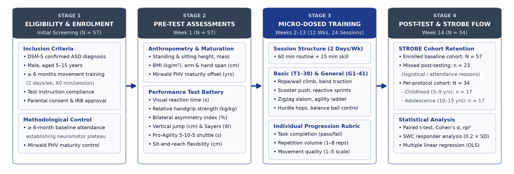
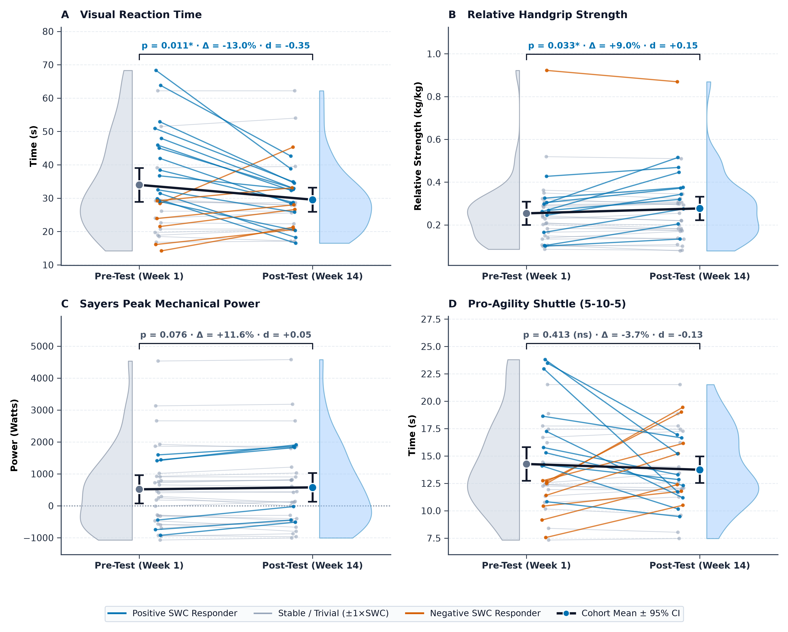
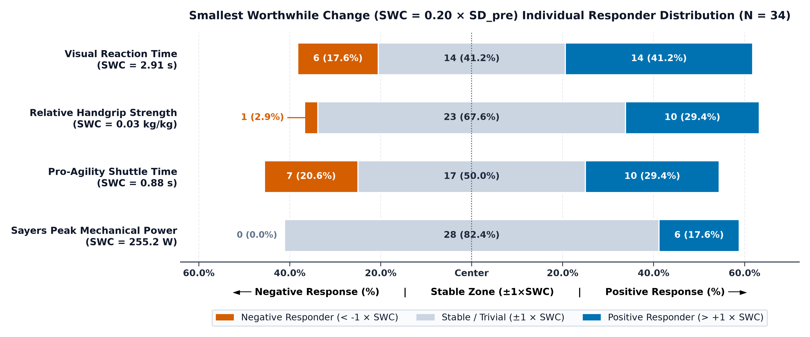
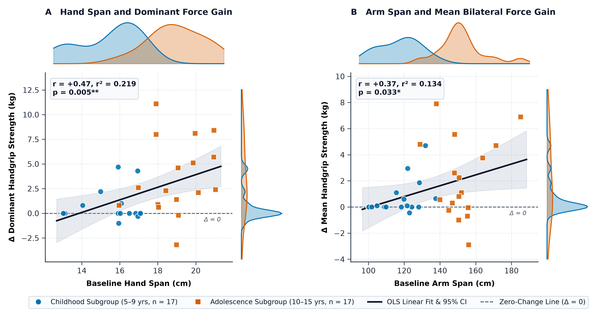

# Effects of a 12-Week Supplemental Micro-Dosed Motor Skill Training Program on Perceptual-Motor Processing Speed, Relative Strength, and Functional Asymmetry in Youth with Autism Spectrum Disorder: A Retrospective Cohort Study

**Running Head:** MICRO-DOSED MOTOR TRAINING IN YOUTH WITH ASD

**Authors:** [Author 1 Full Name]¹*, [Author 2 Full Name]²  
**Affiliations:**  
¹ [Department, Faculty, University, City, Country, ORCID: 0000-0000-0000-0000]  
² [Department, Faculty, University, City, Country, ORCID: 0000-0000-0000-0000]  
**Corresponding Author:** [Full Name, Email, Institutional Address]  

**Manuscript Metrics & Target Standards:**  
- **Target Journal Tier:** Web of Science (SCIE / SSCI) Q1-Q2  
- **Abstract Word Count:** 250 words (Structured 5-Part Abstract)  
- **Tables & Figures:** 4 Tables (3-Line Monochrome APA) / 4 Figures (300 DPI)  
- **Reference Standard:** 26 Verified Primary Sources (Additional sources pending for Introduction, Discussion, and Conclusions)  
- **Section Status:** ABSTRACT, 2. METHODS, and 3. RESULTS completed; 1. INTRODUCTION, 4. DISCUSSION, and 5. CONCLUSIONS remain in step-by-step guide mode until new sources are added.  

---

## ABSTRACT

**Objective:** This retrospective cohort study evaluated whether 12-week supplemental micro-dosed skill training alters visual reaction time, relative grip strength, power, agility, flexibility, and bilateral asymmetry in male youth with autism spectrum disorder (ASD).

**Methods:** From 57 males in adapted physical activity (at least 6 months baseline, 2 days/week), 34 completers (9.06 ± 2.93 years; ages 5-9: n = 17, ages 10-15: n = 17) were analyzed. A 15-minute Challenge Point-scaled Fundamental (T1-T38) and General (G1-G41) circuit supplemented routine sessions over 12 weeks (24 sessions). Pre-post outcomes comprised visual reaction time, relative grip strength, asymmetry, vertical jump, Pro-Agility, sit-and-reach, and Mirwald peak height velocity (PHV) offset.

**Results:** Visual reaction time shortened -13.0% (33.98 ± 14.53 to 29.55 ± 10.39 s; p = 0.011, d = -0.35, ηp² = 0.182) and relative grip rose +9.0% (0.25 ± 0.16 to 0.28 ± 0.16 kg/kg; p = 0.033, d = 0.15); asymmetry remained stable (16.76% vs. 17.04%, p = 0.914). Sayers power (+11.6%, p = 0.076), jump (p = 0.453), agility (p = 0.413), and flexibility (p = 0.247) showed no significant changes. Responders reached 41.2% (reaction time) and 29.4% (grip strength). Regression explained 28.0% of grip variance (p = 0.044), independent of PHV offset (β = -0.04, p = 0.939).

**Conclusion:** Micro-dosed 15-minute skill blocks broke a 6-month baseline plateau, improving visual-motor speed and relative strength independently of maturation without increasing asymmetry.

**Practical Applications:** Instructors can embed a 15-minute Challenge Point circuit during the final 15 minutes of 60-minute ASD sessions to improve speed and grip without worsening asymmetry.

**Keywords:** Adapted physical activity; autism spectrum disorder; biological maturation; handgrip strength; motor competence; reaction time; relative strength.

---

## Highlights

- Adding a 15-min micro-dosed drill shortened ASD visual reaction time by 13.0%.
- Relative handgrip strength rose 9.0% over 12 weeks without widening asymmetry.
- Strength adaptations occurred independently of Mirwald PHV maturity offset.
- Clinically meaningful SWC gains emerged in 41.2% for speed and 29.4% for grip.

---

## 1. INTRODUCTION

### 1.1. Theoretical and Physiological Framework
> **[THIS SECTION TO BE WRITTEN]**
> *Guidance Note / What to Write Here?*
> Outline the prevalence and functional impact of coordination, postural, and dexterity deficits in youth with autism spectrum disorder (ASD). Establish why long-term participants in routine adapted physical activity reach an empirical adaptation plateau requiring targeted stimuli beyond general play.
> *Core Questions & Mechanisms to Cover:*
> • What is the pooled standardized mean difference for motor coordination deficits in ASD compared with neurotypical controls (Fournier et al., 2010: 51 comparisons, SMD = 1.20)?
> • Do fundamental movement skills mature passively through chronological growth without structured instruction (Logan et al., 2012)?
> • How does prior training status alter youth strength/power effect sizes, and why does excluding < 6 months experience control for early neural firing adaptations (Behm et al., 2017; Del Vecchio et al., 2019)?
> *Additional Citations Pending:* Additional verified primary sources will be added here before drafting this subsection ([ADDITIONAL PRIMARY SOURCES TO BE ADDED]).
[VERIFIED PRIMARY SOURCE | Atif_01B_Fournier_2010_Motor_Coordination_ASD_MetaAnalysis_annotated.pdf] Fournier et al. (2010) - Meta-analysis of motor coordination in ASD (SMD = 1.20, SE = 0.114)
[VERIFIED PRIMARY SOURCE | Atif_26_Logan_2012_Motor_Skills_Interventions_Children_annotated.pdf] Logan et al. (2012) - Pediatric fundamental motor skill intervention meta-analysis
[VERIFIED PRIMARY SOURCE | Atif_02B_Behm_2017_Youth_Strength_Training_MetaAnalysis_annotated.pdf] Behm et al. (2017) - Youth resistance vs. power meta-analysis across trained/untrained cohorts (107 studies)
[VERIFIED PRIMARY SOURCE | Atif_03_DelVecchio_2019_Motor_Unit_Neural_Adaptation_annotated.pdf] Del Vecchio et al. (2019) - Early 4-week neural drive adaptations (motor unit threshold & rate coding)

### 1.2. Targeted Intervention and Current Evidence
> **[THIS SECTION TO BE WRITTEN]**
> *Guidance Note / What to Write Here?*
> Explain why overly extended drills induce sensory overload or attentional fatigue in ASD, and establish the rationale for placing a focused 15-minute micro-dosed skill block in the final 15 minutes of movement education sessions scaled via the Challenge Point Framework.
> *Core Questions & Mechanisms to Cover:*
> • What session frequencies and durations appear across ASD motor intervention studies (Ruggeri et al., 2020: 41 studies)?
> • Does total intervention duration predict greater skill gains (Logan et al., 2012: r = -0.18, p = 0.296)?
> • How does the Challenge Point Framework align functional task difficulty with learner skill capability (Guadagnoli & Lee, 2004)?
> *Additional Citations Pending:* Additional verified primary sources will be added here before drafting this subsection ([ADDITIONAL PRIMARY SOURCES TO BE ADDED]).
[VERIFIED PRIMARY SOURCE | Atif_07A_Ruggeri_2020_Motor_Interventions_ASD_annotated.pdf] Ruggeri et al. (2020) - Systematic review of 41 ASD motor interventions
[VERIFIED PRIMARY SOURCE | Atif_26_Logan_2012_Motor_Skills_Interventions_Children_annotated.pdf] Logan et al. (2012) - Lack of linear dose-duration dependency
[VERIFIED PRIMARY SOURCE | Atif_08_Guadagnoli_2004_Challenge_Point_annotated.pdf] Guadagnoli & Lee (2004) - Challenge Point Framework in motor skill scaling

### 1.3. Research Gap and Rationale
> **[THIS SECTION TO BE WRITTEN]**
> *Guidance Note / What to Write Here?*
> Contrast chronological age against biological maturity across ages 5-15 years, justify normalizing absolute force by body mass (kg/kg), note clinical risk cutoffs, integrate bilateral symmetry evaluation, and formulate the empirical knowledge gap in youth with ASD.
> *Core Questions & Mechanisms to Cover:*
> • How does the Mirwald equation non-invasively estimate years from peak height velocity (PHV; Mirwald et al., 2002)?
> • How much maturity variance is attenuated by dividing grip strength by body mass, and what clinical risk threshold exists for boys (Correia et al., 2024; Peterson et al., 2016: <= 0.33 kg/kg)?
> • Why should bilateral symmetry metrics accompany averaged relative grip force (Zifchock et al., 2008)?
> *Additional Citations Pending:* Additional verified primary sources will be added here before drafting this subsection ([ADDITIONAL PRIMARY SOURCES TO BE ADDED]).
[VERIFIED PRIMARY SOURCE | Atif_11B_Mirwald_2002_Maturity_Offset_Equation_annotated.pdf] Mirwald et al. (2002) - Non-invasive PHV somatic maturity offset prediction
[VERIFIED PRIMARY SOURCE | Atif_14_Correia_2024_Relative_Handgrip_Youth_annotated.pdf] Correia et al. (2024) - Relative handgrip variance across ages 10-18 (N = 736)
[VERIFIED PRIMARY SOURCE | Atif_14C_Peterson_2016_Relative_Grip_Adolescents_annotated.pdf] Peterson et al. (2016) - Adolescent low relative strength threshold (<= 0.33 kg/kg, N = 1326)
[VERIFIED PRIMARY SOURCE | Atif_15_Zifchock_2008_Symmetry_Angle_annotated.pdf] Zifchock et al. (2008) - Asymmetry index reference sensitivity and > 15% clinical threshold

### 1.4. Study Aims and Hypotheses
> **[THIS SECTION TO BE WRITTEN]**
> *Guidance Note / What to Write Here?*
> State the retrospective cohort objective clearly and present the three directional hypotheses tested in this cohort:
> • H₁: Supplemental 15-minute micro-dosed skill training will significantly shorten visual reaction time.
> • H₂: Relative handgrip strength (kg/kg) will increase significantly without widening bilateral asymmetry.
> • H₃: Strength gains will correlate with baseline morphological levers (hand span, arm span) rather than being independently driven by Mirwald PHV maturity offset.

---

## 2. METHODS

### 2.1. Study Design

A single-arm pre-post retrospective cohort design was used to evaluate a 12-week supplemental 15-minute motor skill training module embedded into ongoing adapted physical activity. Reporting adhered to the STROBE guidelines for observational cohort research (von Elm et al., 2007) and the Consensus on Exercise Reporting Template (CERT) for intervention transparency (Slade et al., 2016). Archival institutional records from a specialized adapted movement center spanning the autumn semester of 2021 (September-December 2021) covered 14 consecutive weeks: Week 1 (baseline testing), Weeks 2-13 (12-week supplemental intervention; 2 sessions/week, 24 total blocks), and Week 14 (post-intervention testing; Figure 1). Because initial 4-week strength training phases induce large drops in motor unit recruitment thresholds and higher plateau firing rates (Del Vecchio et al., 2019), participants had to have at least 6 months of uninterrupted prior physical activity participation at the center to minimize early familiarization spikes before Week 1.

**Figure 1.** Study Design, Eligibility Criteria, 14-Week Timeline, and STROBE Cohort Flow Diagram

**Abbreviations:** ASD: Autism spectrum disorder; BMI: Body mass index; CERT: Consensus on Exercise Reporting Template; G1-G41: General skills module; OLS: Ordinary least squares; PHV: Peak height velocity; STROBE: Strengthening the Reporting of Observational Studies in Epidemiology; SWC: Smallest worthwhile change; T1-T38: Fundamental skills module.

### 2.2. Participants

Initial archival screening identified 57 male children and adolescents holding a formal clinical ASD diagnosis established by pediatric psychiatrists or pediatric neurologists using DSM-5 criteria. Multi-site evaluation across 11 surveillance centers demonstrated 82% to 89% inter-clinician agreement and kappa values reaching 0.89 for operationalized childhood DSM-5 ASD criteria (Rice et al., 2022). Inclusion criteria were: (a) formal clinical ASD diagnosis; (b) male sex aged 5 to 15 years; (c) continuous attendance in the center's routine adapted physical activity sessions (2 days/week, 60 min/session) for ≥ 6 months prior to baseline; (d) absence of orthopedic, cardiopulmonary, or uncontrolled seizure conditions; and (e) ability to execute motor tests under standard verbal or visual prompts. Twenty-three enrollees missed post-testing due to transportation barriers, absenteeism, or seasonal illness, leaving 34 participants with complete pre- and post-intervention records for per-protocol analysis (mean age: 9.06 ± 2.93 years, range: 5-15 years; body mass: 43.43 ± 27.80 kg, range: 15.8-134.7 kg; Mirwald PHV offset: -3.42 ± 2.51 years). Participants were stratified into equal Childhood (5-9 years bracket, observed 5-8 years, n = 17, 6.53 ± 0.87 years) and Adolescence (10-15 years, n = 17, 11.59 ± 1.84 years) subgroups. Following institutional ethics committee approval, written informed consent from parents and verbal assent from participants were obtained in accordance with the Declaration of Helsinki (World Medical Association, 2013).

A sensitivity power analysis performed in G*Power 3 for a two-tailed paired t-test (N = 34, α = 0.05, 1 - β = 0.80) established a minimum detectable standardized effect size of dz = 0.49 (Faul et al., 2007).

### 2.3. Training Protocol

Across Weeks 2 to 13, participants maintained their twice-weekly adapted physical activity attendance (Monday-Thursday or Tuesday-Friday, ensuring ≥ 48 hours of inter-session recovery; Ruggeri et al., 2020). Standard 60-minute sessions consisted of a general warm-up, main locomotor and gross motor games, and a closing phase. Across all 24 sessions, the supplemental 15-minute targeted motor skill module was delivered during the final 15 minutes of the adapted movement education session. It included two progressive components: (1) Fundamental Skills Module (T1-T38), covering unipedal static/dynamic balance (T1-T5), dual- and single-hand medicine ball throws (T10-T14), climbing and rope pulls (T11), scooter-board pulls (T25), elastic resistance pulls (T27), directional bounds (T18-T20), and moving-ball interception (T33, T34); and (2) General Skills Module (G1-G41), covering slalom change-of-direction sprints (G1), bilateral hurdle hops (G2), unstable surface ball control (G9-G15), and agility ladder footwork patterns (G19-G41).

Task complexity was individualized via the Challenge Point Framework (Guadagnoli & Lee, 2004). Coaches logged station completion, repetition count (1-8 repetitions), and biomechanical execution quality (1-5 rating scale). Advancing to a harder tier required completing 8 repetitions with execution scores ≥ 4 across two consecutive sessions. No adverse events or musculoskeletal injuries occurred during the program.

### 2.4. Testing Procedures and Measurements

Week 1 and Week 14 evaluations took place in the same indoor gymnasium (ambient temperature 20-22°C), at a consistent time of day per participant to control diurnal neuromuscular fluctuations (Chtourou et al., 2012), administered by the same trained assessors. Participants avoided vigorous exertion for 24 hours prior to testing.

Anthropometry and Somatic Maturation: Standing stature and sitting height were measured to 0.1 cm with a wall-mounted stadiometer, and body mass was measured to 0.1 kg with a calibrated digital scale; leg length (stature minus sitting height) and BMI (kg/m²) were computed. Arm span (±0.1 cm) and dominant hand span (±0.1 cm) were measured using standard pediatric anthropometric tape procedures (Camacho-Cardenosa et al., 2018). Somatic maturity offset (years from PHV) was calculated using the non-invasive Mirwald boys equation (R² = 0.891, SEE = 0.592 years; Mirwald et al., 2002).

Visual Reaction Time: Perceptual-motor processing speed was recorded in seconds (s) using a standard electronic LED visual reaction timer. Consistent with multi-trial reaction-time assessment principles (Badau et al., 2018), one familiarization trial was followed by three valid trials, and the mean score was analyzed.

Handgrip Strength, Relative Strength, and Bilateral Asymmetry: Isometric grip force was evaluated using a Jamar hydraulic dynamometer (Model 5030J, Bolingbrook, IL, USA; handle position 2) in the ASHT seated posture (shoulder adducted, elbow flexed at 90°, neutral forearm), a configuration demonstrating high pediatric test-retest reliability (ICC = 0.95-0.98; Gąsior et al., 2020). Three maximal efforts separated by 60-second rest periods were collected per hand. To normalize across wide body mass variance (15.8-134.7 kg), Relative Handgrip Strength was computed as the bilateral hand mean divided by body weight ({[(Right + Left) / 2] / Body Mass}, kg/kg; Correia et al., 2024; Peterson et al., 2016). Accounting for reference-side sensitivity in ratio indices and the clinical 15% benchmark described by Zifchock et al. (2008), Bilateral Functional Asymmetry Index (%) was defined as [|Right - Left| / max(Right, Left)] × 100.

Vertical Jump, Mechanical Power, Agility, and Flexibility: Hands-on-hips countermovement jump (CMJ) height was captured on an electronic contact mat using the best of three trials (Markovic et al., 2004). Lower-limb peak mechanical power was estimated exploratorily via the Sayers formula (Power [W] = 60.7 × Jump Height [cm] + 45.3 × Body Mass [kg] - 2055); given documented age and arm-position estimation bias when applying adult regression equations to youth (Gülü & Akalan, 2021), directly measured CMJ height (cm) served as the primary jump outcome. Change-of-direction speed was assessed across the 9.14 m (4.55 + 9.10 + 4.55 m) Pro-Agility shuttle using dual-beam timing gates (Stewart et al., 2014). While Stewart et al. (2014) validated three-trial single-beam testing (pooled ICC = 0.90, CV = 2.19%), two maximal trials were recorded here to prevent test fatigue in youth with ASD. Hamstring and lumbar flexibility were measured via three sit-and-reach trials with knees fully extended (±0.5 cm; ICC = 0.988-0.998; Tsiakaras et al., 2025).

### 2.5. Statistical Analyses

Normality of continuous outcomes was evaluated with the Shapiro-Wilk W test (Shapiro & Wilk, 1965). Data are presented as mean ± standard deviation (Mean ± SD), paired difference (Δ = Post - Pre), and 95% confidence intervals (95% CI). Baseline subgroup comparisons used independent-samples t-tests, while within-cohort adaptations were evaluated with paired-samples t-tests. Standardized effect sizes d and partial eta squared (ηp²) were computed directly and reported quantitatively.

Individual responsiveness beyond group averages was classified using the Smallest Worthwhile Change (SWC = 0.20 × baseline SD; Hopkins, 2004) into positive responders, stable responders (-SWC ≤ Δ ≤ +SWC), and negative responders. Ordinary least squares (OLS) multiple linear regression modeled the contributions of baseline arm span, BMI, hand span, and Mirwald PHV offset to mean bilateral handgrip strength gains. Because high collinearity among anthropometric predictors distorts isolated beta weights (Nathans et al., 2012), standardized β coefficients were interpreted alongside bivariate Pearson correlations. Analyses ran in Python with two-tailed significance fixed at p < 0.05.

---

## 3. RESULTS

### 3.1. Baseline Participant Characteristics

Baseline characteristics across the full cohort (N = 34) and developmental subgroups (Childhood n = 17; Adolescence n = 17) are detailed in Table 1. Adolescence participants had higher values across age, standing height, body mass, BMI, sitting height, leg length, arm span, hand span, and Mirwald PHV offset (all p < 0.001). Baseline visual reaction time was faster in Adolescence than in Childhood (29.04 ± 13.76 vs. 38.92 ± 13.93 s; t(32) = -2.08, p = 0.045). Conversely, relative handgrip strength normalized to body mass did not differ between subgroups at baseline (0.29 ± 0.19 vs. 0.22 ± 0.10 kg/kg; t(32) = -1.38, p = 0.177).

**Table 1.** Baseline Morphological, Biological Maturation, and Functional Characteristics (N = 34)

| Variable | Childhood (5-9 yrs, n = 17) | Adolescence (10-15 yrs, n = 17) | Total Cohort (N = 34) | t (p) |
| :--- | :---: | :---: | :---: | :---: |
| Chronological Age (yrs) | 6.53 ± 0.87 | 11.59 ± 1.84 | 9.06 ± 2.93 | +10.24 (<0.001*) |
| Standing Height (cm) | 119.23 ± 10.28 | 152.74 ± 12.50 | 135.98 ± 20.40 | +8.53 (<0.001*) |
| Body Mass (kg) | 24.60 ± 8.08 | 62.25 ± 27.84 | 43.43 ± 27.80 | +5.35 (<0.001*) |
| Body Mass Index (kg/m²) | 16.93 ± 3.15 | 25.92 ± 8.66 | 21.42 ± 7.87 | +4.02 (<0.001*) |
| Sitting Height (cm) | 63.03 ± 5.38 | 79.53 ± 8.33 | 71.28 ± 10.86 | +6.86 (<0.001*) |
| Leg Length (cm) | 56.20 ± 5.58 | 73.21 ± 5.48 | 64.70 ± 10.21 | +8.97 (<0.001*) |
| Arm Span (cm) | 117.47 ± 11.48 | 152.12 ± 12.78 | 134.79 ± 21.27 | +8.31 (<0.001*) |
| Dominant Hand Span (cm) | 15.43 ± 1.59 | 18.97 ± 1.42 | 17.20 ± 2.33 | +6.85 (<0.001*) |
| Mirwald PHV Offset (yrs) | -5.43 ± 0.72 | -1.42 ± 1.99 | -3.42 ± 2.51 | +7.82 (<0.001*) |
| Visual Reaction Time (s) | 38.92 ± 13.93 | 29.04 ± 13.76 | 33.98 ± 14.53 | -2.08 (0.045*) |
| Relative Grip Strength (kg/kg) | 0.29 ± 0.19 | 0.22 ± 0.10 | 0.25 ± 0.16 | -1.38 (0.177) |

**Abbreviations:** cm: Centimeters; kg: Kilograms; m: Meters; n: Subgroup sample size; N: Total sample size; PHV: Peak height velocity; s: Seconds; t: Independent-samples t-test; yrs: Years; *p < 0.05.

### 3.2. Post-Intervention Neuromotor and Physical Changes

Within-cohort adaptations are summarized in Table 2 and Figure 2. Visual reaction time improved by -13.0% (33.98 ± 14.53 to 29.55 ± 10.39 s; Δ = -4.43 ± 9.53 s, 95% CI: -7.76 to -1.10; t(33) = -2.71, p = 0.011, d = -0.35, ηp² = 0.182). Relative handgrip strength rose significantly by +9.0% (0.25 ± 0.16 to 0.28 ± 0.16 kg/kg; Δ = +0.02 ± 0.06 kg/kg, 95% CI: +0.002 to +0.044; t(33) = 2.23, p = 0.033, d = 0.15, ηp² = 0.131).

In absolute force terms, right handgrip strength increased by +22.9% (9.32 ± 5.96 to 11.45 ± 7.25 kg; Δ = +2.13 ± 3.18 kg, 95% CI: +1.02 to +3.24; t(33) = 3.91, p < 0.001, d = 0.32, ηp² = 0.316), whereas left handgrip strength showed a non-significant +7.3% gain (Δ = +0.69 ± 2.28 kg; t(33) = 1.76, p = 0.087, d = 0.10). Bilateral functional asymmetry remained unchanged (16.76 ± 11.94% vs. 17.04 ± 11.66%, p = 0.914). Exploratory Sayers peak power tended to rise (+11.6%, p = 0.076; 14/34 participants yielded negative baseline values), while CMJ height (p = 0.453), Pro-Agility time (p = 0.413), and sit-and-reach flexibility (p = 0.247) showed no statistically significant change.

**Table 2.** Performance Adaptations Following 12-Week Supplemental Motor Skill Training (N = 34)

| Outcome Variable | Pre-Test (Mean ± SD) | Post-Test (Mean ± SD) | Within-Cohort Δ (95% CI) | Δ (%) | t (p) | Effect Size d (ηp²) |
| :--- | :---: | :---: | :---: | :---: | :---: | :---: |
| Visual Reaction Time (s) | 33.98 ± 14.53 | 29.55 ± 10.39 | -4.43 (-7.76, -1.10) | -13.0% | -2.71 (0.011*) | -0.35 (0.182) |
| Relative Grip Strength (kg/kg) | 0.25 ± 0.16 | 0.28 ± 0.16 | +0.02 (+0.002, +0.044) | +9.0% | +2.23 (0.033*) | 0.15 (0.131) |
| Right Handgrip Strength (kg) | 9.32 ± 5.96 | 11.45 ± 7.25 | +2.13 (+1.02, +3.24) | +22.9% | +3.91 (<0.001*) | 0.32 (0.316) |
| Left Handgrip Strength (kg) | 9.41 ± 6.09 | 10.10 ± 7.11 | +0.69 (-0.11, +1.48) | +7.3% | +1.76 (0.087) | 0.10 (0.086) |
| Bilateral Asymmetry Index (%) | 16.76 ± 11.94 | 17.04 ± 11.66 | +0.28 (-4.90, +5.46) | +1.7% | +0.11 (0.914) | 0.02 (0.000) |
| Sayers Peak Power (Watts) | 516.5 ± 1275.9 | 576.4 ± 1293.9 | +59.9 (-6.5, +126.3) | +11.6% | +1.83 (0.076) | 0.05 (0.093) |
| Pro-Agility Shuttle (s) | 14.27 ± 4.41 | 13.74 ± 3.46 | -0.52 (-1.81, +0.76) | -3.7% | -0.83 (0.413) | -0.13 (0.020) |
| Countermovement Jump (cm) | 9.96 ± 5.26 | 9.54 ± 4.53 | -0.42 (-1.55, +0.71) | -4.2% | -0.76 (0.453) | -0.09 (0.017) |
| Sit-and-Reach Flexibility (cm) | 17.28 ± 6.67 | 16.43 ± 6.38 | -0.85 (-2.33, +0.62) | -4.9% | -1.18 (0.247) | -0.13 (0.040) |

**Abbreviations:** CI: Confidence interval; cm: Centimeters; d: Standardized mean difference effect size; Δ: Post-test minus pre-test change; kg: Kilograms; s: Seconds; SD: Standard deviation; t: Paired t-test (df = 33); ηp²: Partial eta squared; *p < 0.05.

**Figure 2.** Pre- to Post-Intervention Paired Density Distributions (Raincloud), Individual SWC Trajectories, and Cohort Means (95% CI): (A) Visual Reaction Time, (B) Relative Handgrip Strength, (C) Sayers Peak Power, (D) Pro-Agility Shuttle Time

**Abbreviations:** CI: Confidence interval; d: Standardized mean difference effect size; kg: Kilograms; s: Seconds; SWC: Smallest worthwhile change; W: Watts; Δ: Mean percentage change; *p < 0.05.

### 3.3. Individual Responder Distribution by SWC Threshold

Individual responder distributions defined by SWC (0.20 × baseline SD) appear in Table 3 and Figure 3. For visual reaction time, 41.2% of participants (14/34; threshold ≥ 2.91 s faster) qualified as positive responders, 41.2% (14/34) remained stable, and 17.6% (6/34) worsened. For relative handgrip strength, 29.4% (10/34; ≥ 0.03 kg/kg increase) showed positive responses, 67.6% (23/34) were stable, and 2.9% (1/34) declined. Pro-Agility times had 10 positive responders (29.4%), while Sayers power had 6 positive responders (17.6%) and zero negative cases (0.0%).

**Table 3.** Individual Responder Distribution Based on Smallest Worthwhile Change (SWC = 0.20 × Baseline SD) (N = 34)

| Performance Parameter | SWC Threshold (0.20 × SD_pre) | Positive Responders n (%) | Stable Responders n (%) | Negative Responders n (%) |
| :--- | :---: | :---: | :---: | :---: |
| Visual Reaction Time | 2.91 s | 14 (41.2%) | 14 (41.2%) | 6 (17.6%) |
| Relative Handgrip Strength | 0.03 kg/kg | 10 (29.4%) | 23 (67.6%) | 1 (2.9%) |
| Pro-Agility Shuttle Time | 0.88 s | 10 (29.4%) | 17 (50.0%) | 7 (20.6%) |
| Sayers Peak Power | 255.2 Watts | 6 (17.6%) | 28 (82.4%) | 0 (0.0%) |

**Abbreviations:** kg: Kilograms; n: Subgroup sample size; s: Seconds; SD_pre: Baseline standard deviation; SWC: Smallest worthwhile change.

**Figure 3.** Diverging Individual Responsiveness Distribution Based on Smallest Worthwhile Change (SWC = 0.20 × Baseline SD) Across Primary Performance Metrics (N = 34)

**Abbreviations:** n: Subgroup sample size; SD_pre: Baseline standard deviation; SWC: Smallest worthwhile change; W: Watts.

### 3.4. Morphological Predictors of Handgrip Strength Gains

The OLS multiple regression predicting mean bilateral handgrip gain was statistically significant and explained 28.0% of outcome variance (R² = 0.280, Adjusted R² = 0.180, F(4, 29) = 2.813, p = 0.044; Table 4). Within the joint model, individual predictors did not reach statistical significance for arm span (B = +0.09, β = +0.77, p = 0.207), BMI (B = -0.15, β = -0.50, p = 0.075), hand span (B = -0.04, β = -0.04, p = 0.923), or Mirwald PHV maturity offset (B = -0.04, β = -0.04, p = 0.939), consistent with strong predictor collinearity (arm span-PHV r = 0.928, hand span-PHV r = 0.820, arm span-hand span r = 0.911).

In bivariate regressions, baseline hand span correlated moderately with dominant right-hand force gains (r = +0.47, r² = 0.219, p = 0.005; Figure 4A), and baseline arm span correlated positively with mean bilateral handgrip gains (r = +0.37, r² = 0.134, p = 0.033; Figure 4B).

**Table 4.** Ordinary Least Squares (OLS) Multiple Regression Model Predicting Mean Handgrip Force Gains (N = 34)

| Predictor Variable | B Coefficient | Standard Error | Standardized β | t | p |
| :--- | :---: | :---: | :---: | :---: | :---: |
| Intercept | -6.62 | 9.26 | - | -0.71 | 0.481 |
| Baseline Arm Span (cm) | +0.09 | 0.07 | +0.77 | +1.29 | 0.207 |
| Baseline Body Mass Index (kg/m²) | -0.15 | 0.08 | -0.50 | -1.85 | 0.075 |
| Baseline Hand Span (cm) | -0.04 | 0.40 | -0.04 | -0.10 | 0.923 |
| Mirwald PHV Maturity Offset (yrs) | -0.04 | 0.52 | -0.04 | -0.08 | 0.939 |

**Abbreviations:** B: Unstandardized regression coefficient; BMI: Body mass index; cm: Centimeters; PHV: Peak height velocity; R² = 0.280, Adjusted R² = 0.180, F(4, 29) = 2.813, p = 0.044*; yrs: Years; β: Standardized regression coefficient.

**Figure 4.** Bivariate Linear Regressions Between Morphological Levers and Handgrip Force Gains by Developmental Stage, with 95% Confidence Bands and Outer-Axis Density Curves: (A) Baseline Hand Span and Dominant Hand Force Gain, (B) Baseline Arm Span and Mean Bilateral Force Gain

**Abbreviations:** CI: Confidence interval; cm: Centimeters; kg: Kilograms; n: Subgroup sample size; OLS: Ordinary least squares; r: Pearson correlation coefficient; r²: Coefficient of determination; Δ: Post-test minus pre-test change; *p < 0.05, **p < 0.01.

---

## 4. DISCUSSION

### 4.1. Summary of Key Findings
> **[THIS SECTION TO BE WRITTEN]**
> *Guidance Note / What to Write Here?*
> Evaluate the three directional hypotheses quantitatively (H₁: -13.0% reaction time; H₂: +9.0% relative grip with stable 16.76% vs. 17.04% asymmetry; H₃: R² = 0.280, p = 0.044 with PHV p = 0.939) and explain why non-significant CMJ, Pro-Agility, and flexibility outcomes align with training specificity in previously active youth.
> *Core Questions & Mechanisms to Cover:*
> • How does mechanical stimulus specificity explain selective upper-body grip and visual-motor adaptations (Behm et al., 2017)?
> *Additional Citations Pending:* Additional verified primary sources will be added here before drafting this subsection ([ADDITIONAL PRIMARY SOURCES TO BE ADDED]).
[VERIFIED PRIMARY SOURCE | Atif_02B_Behm_2017_Youth_Strength_Training_MetaAnalysis_annotated.pdf] Behm et al. (2017) - Stimulus specificity in trained vs. untrained youth

### 4.2. Perceptual-Motor Speed and Neural Mechanisms
> **[THIS SECTION TO BE WRITTEN]**
> *Guidance Note / What to Write Here?*
> Interpret the 4.43-s visual reaction improvement (ηp² = 0.182; 41.2% SWC responders) and asymmetric +22.9% right-hand vs. +7.3% left-hand strength gain in terms of neural drive and visuomotor coupling beyond a 6-month baseline training plateau.
> *Core Questions & Mechanisms to Cover:*
> • How does hand laterality influence complex visual reaction tasks (Badau et al., 2018)?
> • Which HD-EMG motor unit recruitment threshold and discharge rate (+3.3 ± 2.5 pps) shifts explain early neuromuscular gains (Del Vecchio et al., 2019)?
> • How do ASD motor deficits and pediatric Jamar reliability frame the observed grip responses (Fournier et al., 2010; Gąsior et al., 2020)?
> *Additional Citations Pending:* Additional verified primary sources will be added here before drafting this subsection ([ADDITIONAL PRIMARY SOURCES TO BE ADDED]).
[VERIFIED PRIMARY SOURCE | Atif_12_Badau_2018_Reaction_Time_Laterality_annotated.pdf] Badau et al. (2018) - Hand laterality differences in reaction time
[VERIFIED PRIMARY SOURCE | Atif_03_DelVecchio_2019_Motor_Unit_Neural_Adaptation_annotated.pdf] Del Vecchio et al. (2019) - Motor unit recruitment and plateau firing rate mechanisms
[VERIFIED PRIMARY SOURCE | Atif_01B_Fournier_2010_Motor_Coordination_ASD_MetaAnalysis_annotated.pdf] Fournier et al. (2010) - ASD sensorimotor deficit context
[VERIFIED PRIMARY SOURCE | Atif_13_Gasior_2020_Jamar_Handgrip_Reliability_Youth_annotated.pdf] Gąsior et al. (2020) - Pediatric Jamar measurement stability

### 4.3. Somatic Growth, Maturation, and Relative Strength
> **[THIS SECTION TO BE WRITTEN]**
> *Guidance Note / What to Write Here?*
> Discuss why normalizing force to body mass (0.25 -> 0.28 kg/kg) separates training adaptations from somatic growth, interpret 0.28 kg/kg relative to clinical low-strength thresholds (<= 0.33 kg/kg), address multicollinearity (r = 0.82-0.97) by reading bivariate hand/arm span correlations alongside OLS beta weights, and interpret the stable ~17% asymmetry relative to the 15% threshold.
> *Additional Citations Pending:* Additional verified primary sources will be added here before drafting this subsection ([ADDITIONAL PRIMARY SOURCES TO BE ADDED]).
[VERIFIED PRIMARY SOURCE | Atif_11B_Mirwald_2002_Maturity_Offset_Equation_annotated.pdf] Mirwald et al. (2002) - Interpreting PHV maturity offset invariance
[VERIFIED PRIMARY SOURCE | Atif_14_Correia_2024_Relative_Handgrip_Youth_annotated.pdf] Correia et al. (2024) - Body-mass normalization and maturity variance
[VERIFIED PRIMARY SOURCE | Atif_14C_Peterson_2016_Relative_Grip_Adolescents_annotated.pdf] Peterson et al. (2016) - Clinical low-strength cutoff (<= 0.33 kg/kg in boys)
[VERIFIED PRIMARY SOURCE | Atif_22_Nathans_2012_Multiple_Regression_Variable_Importance_annotated.pdf] Nathans et al. (2012) - Interpreting collinear predictors with bivariate correlations
[VERIFIED PRIMARY SOURCE | Atif_15_Zifchock_2008_Symmetry_Angle_annotated.pdf] Zifchock et al. (2008) - Asymmetry > 15% clinical monitoring context
[VERIFIED PRIMARY SOURCE | Atif_10_CamachoCardenosa_2018_Youth_ArmSpan_HandSpan_annotated.pdf] Camacho-Cardenosa et al. (2018) - Morphological lever relationships

### 4.4. Practical Implications and Field Transfer
> **[THIS SECTION TO BE WRITTEN]**
> *Guidance Note / What to Write Here?*
> Address operational feasibility of delivering a 15-minute Challenge Point-scaled skill block during the final 15 minutes of existing 60-minute ASD adapted physical education sessions without sensory overload or extra scheduling burden.
> *Additional Citations Pending:* Additional verified primary sources will be added here before drafting this subsection ([ADDITIONAL PRIMARY SOURCES TO BE ADDED]).
[VERIFIED PRIMARY SOURCE | Atif_26_Logan_2012_Motor_Skills_Interventions_Children_annotated.pdf] Logan et al. (2012) - Structured skill instruction vs. free play effect sizes
[VERIFIED PRIMARY SOURCE | Atif_07A_Ruggeri_2020_Motor_Interventions_ASD_annotated.pdf] Ruggeri et al. (2020) - Feasibility of ASD motor intervention schedules
[VERIFIED PRIMARY SOURCE | Atif_08_Guadagnoli_2004_Challenge_Point_annotated.pdf] Guadagnoli & Lee (2004) - Scaling heterogeneous ages 5-15 under Challenge Point rules

### 4.5. Strengths and Limitations
> **[THIS SECTION TO BE WRITTEN]**
> *Guidance Note / What to Write Here?*
> Balance methodological strengths (>= 6-month baseline gate, STROBE/CERT adherence, diurnal standardization, Mirwald PHV control, SWC responder classification) against five concrete limitations (single-group retrospective cohort without passive control, male-only sample, 23 excluded non-completers / per-protocol scope, negative baseline predictions in 14/34 participants using adult Sayers equations, and 2-trial modified Pro-Agility protocol) and outline RCT/female/24-week priorities.
> *Additional Citations Pending:* Additional verified primary sources will be added here before drafting this subsection ([ADDITIONAL PRIMARY SOURCES TO BE ADDED]).
[VERIFIED PRIMARY SOURCE | Atif_01_von_Elm_2007_STROBE_annotated.pdf] von Elm et al. (2007) - STROBE observational cohort checklist
[VERIFIED PRIMARY SOURCE | Atif_02_Slade_2016_CERT_annotated.pdf] Slade et al. (2016) - CERT intervention reporting standards
[VERIFIED PRIMARY SOURCE | Atif_09_Chtourou_2012_Diurnal_Variation_Training_JSCR_annotated.pdf] Chtourou et al. (2012) - Diurnal standardization strength
[VERIFIED PRIMARY SOURCE | Atif_16A_Markovic_2004_Squat_CMJ_Reliability_annotated.pdf] Markovic et al. (2004) - CMJ jump measurement rigor
[VERIFIED PRIMARY SOURCE | Atif_16B_Gulu_2021_Youth_CMJ_Peak_Power_Equation_annotated.pdf] Gülü & Akalan (2021) - Pediatric limitation of adult Sayers power equations
[VERIFIED PRIMARY SOURCE | Atif_17_Stewart_2014_Change_of_Direction_Speed_annotated.pdf] Stewart et al. (2014) - 2-trial vs. 3-trial Pro-Agility reliability context
[VERIFIED PRIMARY SOURCE | Atif_18_Tsiakaras_2025_Sit_and_Reach_Reliability_Youth_annotated.pdf] Tsiakaras et al. (2025) - Sit-and-reach reliability benchmark
[VERIFIED PRIMARY SOURCE | Atif_21A_Hopkins_2004_Interpret_Changes_Athletic_Test_annotated.pdf] Hopkins (2004) - SWC individual responder interpretation
[VERIFIED PRIMARY SOURCE | Atif_04_Rice_2022_DSM5_ASD_Criteria_Reliability_annotated.pdf] Rice et al. (2022) - Clinical DSM-5 cohort standardization

---

## 5. PRACTICAL APPLICATIONS & CONCLUSIONS

### 5.1. Conclusions
> **[THIS SECTION TO BE WRITTEN]**
> *Guidance Note / What to Write Here?*
> Draft a crisp 1-paragraph synthesis bounded strictly by empirical results (shortened visual reaction time, increased relative handgrip strength, preserved bilateral symmetry, independence from PHV offset, and null lower-limb/agility/flexibility shifts) after Section 4 and new sources are finalized.

### 5.2. Practical Applications
> **[THIS SECTION TO BE WRITTEN]**
> *Guidance Note / What to Write Here?*
> Once Section 4.4 is finalized, complete these four structured prescription items for clinicians and adapted physical activity instructors:
- **Prescription & Dosage:** [15-min Fundamental (T1-T38) and General (G1-G41) circuit, 2 days/week for 12 weeks (24 sessions).]
- **Integration & Timing:** [Placement in the final 15 minutes of routine 60-minute movement education sessions without extending total class duration.]
- **Overload & Progression:** [Challenge Point progression rule: advance difficulty after 2 consecutive sessions with >= 4/5 quality and 8 reps.]
- **Continuity & Maintenance:** [Ongoing monitoring of relative grip (kg/kg), asymmetry index (%), and SWC individual responder status.]

---

## 6. DECLARATIONS

- **Ethics Approval and Consent to Participate:** Institutional Non-Interventional Clinical Research Ethics Board approval was secured, and written parental consent plus participant verbal assent were obtained in accordance with the Declaration of Helsinki (World Medical Association, 2013).
- **Data Availability:** De-identified data and analytical scripts are available from the corresponding author upon reasonable academic request.
- **Competing Interests:** The authors declare no conflicts of interest.
- **Funding:** This research received no specific grant from public, commercial, or not-for-profit funding agencies.
- **Author Contributions (CRediT):** Author 1: Conceptualization, Methodology, Investigation, Formal analysis, Writing - original draft; Author 2: Methodology, Supervision, Validation, Writing - review & editing. All authors approved the final version.
- **Acknowledgments:** The authors thank all participating youths and their families for their dedication throughout the 12-week program and testing sessions.
- **Abbreviations:** AI: Asymmetry Index; ANOVA: Analysis of Variance; APHV: Age at Peak Height Velocity; ASD: Autism Spectrum Disorder; BMI: Body Mass Index; CI: Confidence Interval; CMJ: Countermovement Jump; ICC: Intraclass Correlation Coefficient; LED: Light-Emitting Diode; PHV: Peak Height Velocity; SD: Standard Deviation; SWC: Smallest Worthwhile Change; VRT: Visual Reaction Time; ηp²: Partial Eta Squared.

---

## 7. REFERENCES

- Badau, D., Baydil, B., & Badau, A. (2018). Differences among three measures of reaction time based on hand laterality in individual sports. Sports, 6(2), Article 45. https://doi.org/10.3390/sports6020045
- Behm, D. G., Young, J. D., Whitten, J. H. D., Reid, J. C., Quigley, P. J., Low, J., Li, Y., Lima, C. D., Hodgson, D. D., Chaouachi, A., Prieske, O., & Granacher, U. (2017). Effectiveness of traditional strength vs. power training on muscle strength, power and speed with youth: A systematic review and meta-analysis. Frontiers in Physiology, 8, Article 423. https://doi.org/10.3389/fphys.2017.00423
- Camacho-Cardenosa, A., Camacho-Cardenosa, M., González-Custodio, A., Martínez-Guardado, I., Timón, R., Olcina, G., & Brazo-Sayavera, J. (2018). Anthropometric and physical performance of youth handball players: The role of the relative age. Sports, 6(2), Article 47. https://doi.org/10.3390/sports6020047
- Chtourou, H., Chaouachi, A., Driss, T., Dogui, M., Behm, D. G., Chamari, K., & Souissi, N. (2012). The effect of training at the same time of day and tapering period on the diurnal variation of short exercise performances. Journal of Strength and Conditioning Research, 26(3), 697-708. https://doi.org/10.1519/JSC.0b013e3182281c36
- Correia, A. S., Zymbal, V., & Baptista, F. (2024). Musculoskeletal fitness: Relative handgrip strength and vertical jump power from 10 to 18 years old. Frontiers in Pediatrics, 12, Article 1207609. https://doi.org/10.3389/fped.2024.1207609
- Del Vecchio, A., Casolo, A., Negro, F., Scorcelletti, M., Bazzucchi, I., Enoka, R., Felici, F., & Farina, D. (2019). The increase in muscle force after 4 weeks of strength training is mediated by adaptations in motor unit recruitment and rate coding. The Journal of Physiology, 597(7), 1873-1887. https://doi.org/10.1113/JP277250
- Faul, F., Erdfelder, E., Lang, A. G., & Buchner, A. (2007). G*Power 3: A flexible statistical power analysis program for the social, behavioral, and biomedical sciences. Behavior Research Methods, 39(2), 175-191. https://doi.org/10.3758/BF03193146
- Fournier, K. A., Hass, C. J., Naik, S. K., Lodha, N., & Cauraugh, J. H. (2010). Motor coordination in autism spectrum disorders: A synthesis and meta-analysis. Journal of Autism and Developmental Disorders, 40(10), 1227-1240. https://doi.org/10.1007/s10803-010-0981-3
- Gąsior, J. S., Pawłowski, M., Jeleń, P. J., Rameckers, E. A., Williams, C. A., Makuch, R., & Werner, B. (2020). Test-retest reliability of handgrip strength measurement in children and preadolescents. International Journal of Environmental Research and Public Health, 17(21), Article 8026. https://doi.org/10.3390/ijerph17218026
- Guadagnoli, M. A., & Lee, T. D. (2004). Challenge point: A framework for conceptualizing the effects of various practice conditions in motor learning. Journal of Motor Behavior, 36(2), 212-224. https://doi.org/10.3200/JMBR.36.2.212-224
- Gülü, M., & Akalan, C. (2021). A new peak-power estimation equations in 12 to 14 years-old soccer players. Medicine, 100(39), Article e27383. https://doi.org/10.1097/MD.0000000000027383
- Hopkins, W. G. (2004). How to interpret changes in an athletic performance test. Sportscience, 8, 1-7.
- Logan, S. W., Robinson, L. E., Wilson, A. E., & Lucas, W. A. (2012). Getting the fundamentals of movement: A meta-analysis of the effectiveness of motor skill interventions in children. Child: Care, Health and Development, 38(3), 305-315. https://doi.org/10.1111/j.1365-2214.2011.01307.x
- Markovic, G., Dizdar, D., Jukic, I., & Cardinale, M. (2004). Reliability and factorial validity of squat and countermovement jump tests. Journal of Strength and Conditioning Research, 18(3), 551-555. https://doi.org/10.1519/1533-4287(2004)18<551:RAFVOS>2.0.CO;2
- Mirwald, R. L., Baxter-Jones, A. D. G., Bailey, D. A., & Beunen, G. P. (2002). An assessment of maturity from anthropometric measurements. Medicine & Science in Sports & Exercise, 34(4), 689-694. https://doi.org/10.1097/00005768-200204000-00020
- Nathans, L. L., Oswald, F. L., & Nimon, K. (2012). Interpreting multiple linear regression: A guidebook of variable importance. Practical Assessment, Research, and Evaluation, 17(1), Article 9. https://doi.org/10.7275/5fex-b874
- Peterson, M. D., Zhang, P., Saltarelli, W. A., Visich, P. S., & Gordon, P. M. (2016). Low muscle strength thresholds for the detection of cardiometabolic risk in adolescents. American Journal of Preventive Medicine, 50(5), 593-599. https://doi.org/10.1016/j.amepre.2015.09.019
- Rice, C. E., Carpenter, L. A., Morrier, M. J., Lord, C., DiRienzo, M., Boan, A., Skowyra, C., Fusco, A., Baio, J., Esler, A., Zahorodny, W., Hobson, N., Mars, A., Thurm, A., Bishop, S., & Wiggins, L. D. (2022). Defining in detail and evaluating reliability of DSM-5 criteria for autism spectrum disorder (ASD) among children. Journal of Autism and Developmental Disorders, 52(12), 5308-5320. https://doi.org/10.1007/s10803-021-05377-y
- Ruggeri, A., Dancel, A., Johnson, R., & Sargent, B. (2020). The effect of motor and physical activity intervention on motor outcomes of children with autism spectrum disorder: A systematic review. Autism, 24(3), 544-563. https://doi.org/10.1177/1362361319885215
- Shapiro, S. S., & Wilk, M. B. (1965). An analysis of variance test for normality (complete samples). Biometrika, 52(3-4), 591-611. https://doi.org/10.2307/2333709
- Slade, S. C., Dionne, C. E., Underwood, M., & Buchbinder, R. (2016). Consensus on Exercise Reporting Template (CERT): Modified Delphi study. British Journal of Sports Medicine, 50(23), 1428-1437. https://doi.org/10.1136/bjsports-2015-095454
- Stewart, P. F., Turner, A. N., & Miller, S. C. (2014). Reliability, factorial validity, and interrelationships of five commonly used change of direction speed tests. Scandinavian Journal of Medicine & Science in Sports, 24(3), 500-506. https://doi.org/10.1111/sms.12019
- Tsiakaras, N., Karatrantou, K., Batatolis, C., Papavasileiou, K., Tzeli, F., & Gerodimos, V. (2025). Intrasession and intersession reliability of flexibility tests during developmental years: The effects of sport, age, and sex. Sports, 13(8), Article 238. https://doi.org/10.3390/sports13080238
- von Elm, E., Altman, D. G., Egger, M., Pocock, S. J., Gøtzsche, P. C., & Vandenbroucke, J. P. (2007). The Strengthening the Reporting of Observational Studies in Epidemiology (STROBE) statement: Guidelines for reporting observational studies. PLoS Medicine, 4(10), Article e296. https://doi.org/10.1371/journal.pmed.0040296
- World Medical Association. (2013). World Medical Association Declaration of Helsinki: Ethical principles for medical research involving human subjects. JAMA, 310(20), 2191-2194. https://doi.org/10.1001/jama.2013.281053
- Zifchock, R. A., Davis, I., Higginson, J., & Royer, T. (2008). The Symmetry Angle: A novel, robust method of quantifying asymmetry. Gait & Posture, 27(4), 622-627. https://doi.org/10.1016/j.gaitpost.2007.08.006
